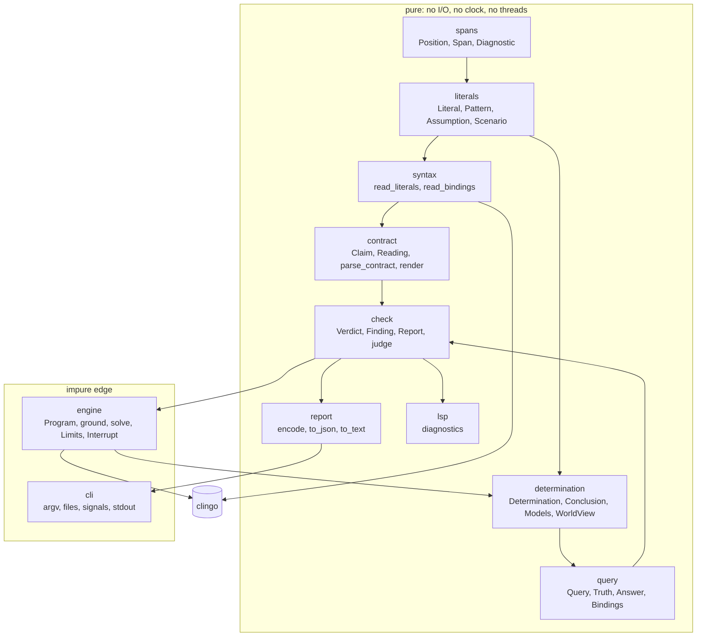
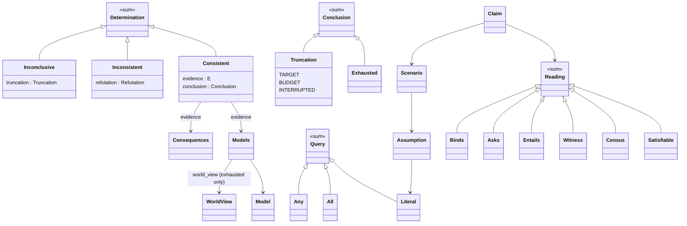

# aspnext — the design of elenctic's successor

2026-10-30. `aspnext` is a working codename (see §7). Location of the MVP: `/workspace/elenctic-next`.
Everything here was built and measured on the box; §12 lists what was not checked.

## 1. Goals

1. A **library first**: a pure, typed API with no printing, no global caps, budgets as parameters,
   source spans on everything a user wrote, results as data, and cancellable searches.
2. A **thin command line** over it, whose JSON is derived from the result types.
3. A **second thin client** is possible without library changes: an editor plugin through a Language
   Server (§4.4).
4. Names that make correctness obvious to an ASP expert: the register of themelios's query and solve
   layers (§10).
5. Lean code. In-code documentation says what a thing is; history lives in the changelog.
6. Standards: PEP 621/735, `py.typed`, `mypy --strict`, `ruff` with `select = ["ALL"]`, pytest and
   hypothesis, Diátaxis docs, semver, Keep a Changelog, MIT.
7. Installable through uv, pixi and conda-forge; PyPI-ready metadata.

Non-goals for the MVP: clingcon, `@optimal`/`@cost`/`@assign`, corpus layouts, the language server
process itself (§11).

## 2. The review's weaknesses, and the issues

elenctic has **no open issues** (19, all closed; the open-state query returned `[]`). The closed
issues #1–#14 are treated as regression constraints; #15–#19 are releases and docs.

### 2.1 Review weaknesses

| Weakness in elenctic (review 2026-10-30) | In aspnext | Evidence |
|---|---|---|
| Query kernel not in the public `__all__` | Kernel exported from the package: `Literal`, `Pattern`, `Query`, `Answer`, `answer`, `singleton_answer`, `bindings`, `world_view`, `solve`, `Assumption` | `tests/test_public.py` |
| ~40% of lines are comments and docstrings, with bug narratives | 7.1% (one comment line, 96 docstring lines in 1,368 non-blank source lines); elenctic measured 42.3% with the same script | `scratch/ratio.py` |
| 8 control-layer functions over 60 lines | 0 over 60, 0 over 40; longest 23 lines | AST count |
| `parse_query('yes','{ p("a=b") }')` raises | Literal lists are read by clingo's own parser, not split by hand; the case is a test | `test_contract.py:79` |
| Hand-rolled `_parse_goal` | Removed: `syntax.read_literals` / `read_bindings` use clingo's AST | `syntax.py` |
| Speculative `unify` | Removed: `Pattern.match` and `bindings` over a world view | `literals.py`, `query.py` |
| "Only impure module" overclaim | Stated honestly: `engine` (clingo control, threads, clock), `Program.read` and `cli` (files, signals, stdout) are impure; everything else is pure | §4.1 |
| Fixed `MODEL_CAP` of 1,000,000 and a fixed per-solve budget | `Limits(seconds, models)` per call; `--budget`, `--models` | `engine.py` |
| No assumptions form | `assuming { l, not l }` on any claim, and `Scenario` in the library; unsatisfied assumptions return a core | `contract.py`, `engine.py` |
| `#maximize` costs negated | Not reproduced: costs are deferred (M1); decision recorded in §9 | — |
| Git-only distribution | uv wheel built and installed in a clean venv; pixi environment solved and `pixi run check` green; rattler-build conda package built, its import and `pip check` tests passed | §6 |
| ruff ISC004 drift | `ruff check` and `ruff format --check` clean over `src tests scripts`, in the gate | `check.sh` |

### 2.2 Closed issues as regression constraints

| # | Title (abridged) | Status in aspnext |
|---|---|---|
| 1 | Project the optimal class for shown-only optimal modes on theory solvers | Deferred (M1/M3): `@optimal` is "not supported yet" |
| 2 | Structured `--json` output | Done; derived from the result types |
| 3 | `elenctic <file.lp>` single-file invocation | Done: paths are files or directories |
| 4, 5 | `AS(P)` tags must mean all of `AS(P)` on optimizing programs | Done by law: `opt_mode=ignore`; a test enumerates both models of `{p}. #minimize { 1 : p }.` |
| 6 | Solve-time faults escape as tracebacks | `ground` returns `Fault`; `check` returns `Report \| Fault \| None`; nothing raises |
| 7, 9 | A non-exhaustive search reported as a complete enumeration | A `WorldView` can be built only from an exhausted search (`world_view` returns the `Truncation` otherwise); census, cautious, `@query` and bindings claims are `undecided` on a truncated search |
| 8 | Route escaping solver outcomes to their registers | `Determination = Consistent \| Inconsistent \| Inconclusive`, matched exhaustively |
| 10 | `@expect sat` UNDECIDED when the enumeration did not finish | A found model is a witness: `pass`, whatever the search did after it |
| 11 | Untrusted `.lp` cannot read past the corpus boundary | **Not addressed.** `Program.path` lets `#include` resolve beside the file; no corpus walk exists yet. M1 |
| 12 | One fault owner per region | `Locus.PROGRAM \| REQUEST` on every `Fault` |
| 13 | AST walk's recursion limit reachable from a `.lp` | No recursion over program text. **Measured:** terms nested 10,000 deep are fine; 100,000 deep segfaults inside clingo's own `parse_string` (reproduced with plain clingo, no aspnext). Containment needs a process per file (§9, D5) |
| 14 | Memory exhaustion costs the whole run | **Not addressed** (same remedy as 13) |

## 3. Semantics kept, and where they depart

Kept from elenctic: the contract format, the three verdicts, exit codes 0/1/2, the text report shape,
three-valued answers (Gelfond–Kahl Def. 2.2.2), `@count 0` against `@expect sat` being ill-formed,
`@expect unsat` admitting no model claim except `@count 0`. A **differential run** (§8) found no
disagreement on any claim both tools run.

Departures (each a decision for you; §9):

- Several `@model` claims per contract are allowed, each an independent existential claim.
  elenctic rejects a second one ("at most one @model per contract").
- `assuming { … }` is new.
- Elenctic's collapsed `@count 0` row under `@expect unsat` is shown as two claims.
- `where`, `@optimal`, `@cost`, `@assign`, `@elenctic`, clingcon, discovery/corpus layout, the
  contrary-shown precondition for `no`/`unknown` queries, and `--explain` are not yet carried.
- Cores are sufficient, not minimal.

## 4. Architecture

### 4.1 Layers



`check` calls `engine` for its searches; `judge` (claim, determination → finding) is pure and is
where verdict logic lives.

### 4.2 The ontology

Types are designed from is-a relations of the domain; sum types are `type X = A | B` aliases,
dispatch is `match`.



Facts the shapes carry, so no comment need: `Models` has a `first` model (a consistent search has
one); `WorldView` refuses an empty set; `Inconsistent` is derived from "no model and exhausted", never
from clingo's `unsatisfiable` flag (which a cancelled search can also raise); `Limits` refuses
negative numbers.

Verdict logic is two functions: existential (`found` → pass; else fail if closed; else undecided)
and universal (`refuted` → fail; else pass if closed; else undecided). Each reading is one of them,
or a small combination (`Census`).

### 4.3 Public API (excerpt)

```python
from aspnext import Limits, Program, check, solve, Literal, Assumption

report = check(Program.read(path), limits=Limits(seconds=10, models=10_000))
found = solve(program, scenario=frozenset({Assumption(Literal.parse("p"), holds=True)}))
```

- `check(program, *, limits, interrupt) -> Report | Fault | None`; `None` means no contract.
- `solve(...) -> Determination[Models] | Fault`; `Grounded.consequences(mode, ...)` for native
  cautious/brave over shown atoms.
- `Interrupt().pull()` from any thread ends a search with `Truncation.INTERRUPTED`.
- All public names are in `aspnext.__all__`; results are frozen, slotted dataclasses.

### 4.4 Command line and editor plugin

The CLI is `argv → Run → text|JSON → exit code` (about 70 lines). Real output:

```
$ aspnext bad.lp
bad.lp — FAIL
  [FAIL] @cautious { tea } (line 2): { tea } ⊆ ⋂ AS(P) = { biscuit } (missing: { tea })
  [FAIL] @model { biscuit, tea } assuming { coffee } (line 3): { biscuit, tea } shown by an answer set: no

0/1 passed, 1 fail
```

A **language server** (pygls) is the recommended second client for VS Code and Zed, because both speak
LSP and neither needs a bespoke plugin API. `aspnext.lsp.diagnostics(result)` already maps a `Report`
or `Fault` to LSP diagnostics (0-based ranges from half-open spans, severities 1/2/3), with tests;
the server around it (document sync, a cancellable `check` per save through `Interrupt`) is **not
written** and needs pygls. Alternative: a VS Code extension shelling out to `aspnext --json` (no
server, no cancellation).

### 4.5 JSON

`encode` is structural: a dataclass becomes `{"kind": TypeName, field: …}`; enums by value;
frozensets sorted; a class object raises `TypeError`. Top level `{"schema": 1, "run": …,
"exit_code": n}`. The schema is a consequence of the types, not a second definition.

## 5. Standards and packaging

| Item | State |
|---|---|
| `pyproject.toml` PEP 621 + `[dependency-groups]` (PEP 735), hatchling, `py.typed`, MIT, `license-files` | done |
| `mypy --strict` plus extra error codes, `warn_unreachable` | clean, 12 files |
| `ruff` `select = ["ALL"]` (a short ignore list for docstring rules and formatter conflicts), `ruff format` | clean |
| pytest + hypothesis | 182 tests |
| Python | `>=3.14` (PEP 695 generics and aliases, `match`, `StrEnum`, slotted frozen dataclasses, `NamedTuple`) |
| Docs | Diátaxis skeleton: tutorial, how-to, reference, explanation (`docs/`) |
| Changelog | Keep a Changelog; semver; version 0.0.0 |
| CI | `.github/workflows/ci.yml` written (uv gates on Linux/macOS, pixi, rattler-build); **never run** |

## 6. Distribution

- **uv / PyPI**: `uv build` produced an sdist and wheel; the wheel installed into a clean venv and
  `aspnext --help` ran. PyPI upload not done (and not to be done without you).
- **pixi**: `[tool.pixi.*]` in `pyproject.toml` (pixi 0.83.0 from the GitHub release; sha256 matched).
  `pixi install` solved from conda-forge; `pixi run check` ran the whole gate green; `pixi.lock`
  committed. Platforms listed: linux-64, osx-arm64, osx-64, win-64; **only linux-64 was solved here**.
- **conda-forge**: `recipe/recipe.yaml` (rattler-build 0.80.0, `noarch: python`). `rattler-build build`
  produced `aspnext-0.0.0-….conda`; its python-imports test and `pip check` passed. A staged-recipes
  submission needs a real source URL and sha256 (the recipe builds from `path: ..`) and a public
  repository, so it is **unverified as a conda-forge submission**.

## 7. Naming and lineage

Register: Greek abstract nouns for an activity, as in themelios (foundation) and zetesis (inquiry).
The library's own contribution is *checking a program against what it must satisfy*.

Availability, checked 2026-10-30 against `https://pypi.org/pypi/<name>/json` and
`https://api.anaconda.org/package/conda-forge/<name>` (404 means free; availability can change):

| Candidate | Greek | Meaning | Fit | PyPI | conda-forge |
|---|---|---|---|---|---|
| **dokimasia** | δοκιμασία | the scrutiny an Athenian underwent before taking office; an assay or trial | A program qualifies for use by passing its tests; close to "contract check" | free | free |
| **peirasis** | πεῖρασις | trial, attempt, putting to the test | Short sense of "test"; weaker on "against a stated standard" | free | free |
| **apodeixis** | ἀπόδειξις | demonstration, proof | Over-claims: verdicts are checks of claims, not proofs | free | free |
| **exetasis** | ἐξέτασις | close examination, audit | Good for audit; clumsy to type | free | free |
| elenctic (unchanged) | ἔλεγχος | refutation by cross-examination | Already his; the claims-as-challenges idea | free | free |
| *basanos* | βάσανος | touchstone | Best fit, **taken** on PyPI (an unrelated finance library) | taken | free |
| *elenchos*/*elenchus* | ἔλεγχος | the noun | **taken** on PyPI (a Nagios framework; a knowledge-base tool) | taken | free |

**Lean:** if you want a clean break, `dokimasia`. If you want continuity, keep `elenctic`:
it is free on both indexes, anakrisis already depends on it, and it is a name you like.

Lineage options, not decided:

1. **Same name, same repo, 1.0.0.** Keeps history, stars, the pin anakrisis already has; a major
   version marks the break. The 0.x line stays tagged. Cost: the rewrite shares a history with code
   that is nothing like it.
2. **Same name, new repo.** Clean history; the old repo is archived with a pointer. Cost: splits
   references.
3. **New name.** Clean break, no confusion in `pip install` for anyone pinned to 0.3; cost is a new
   identity and the name hesitation you described.

`scripts/rename.sh NEWNAME` renames the codename in every tracked file and the package directory;
tested on a copy (renamed to `dokimasia`, the 182 tests passed, the console script ran).

## 8. Differential check against elenctic

`scripts/differential.py` generates random contracts (atoms a, b, c with strong negation), runs
elenctic 0.3.1 (`main`, `--format json`) in a subprocess and aspnext in-process, and compares
verdicts per claim.

| seed | cases | verdicts compared | disagreements | only aspnext |
|---|---|---|---|---|
| 1 | 400 | 1,603 | 0 | 161 |
| 2 | 400 | 1,626 | 0 | 178 |
| 3 | 400 | 1,697 | 0 | 165 |

"Only aspnext" are the collapsed `@count 0` rows, extra `@model` claims, and 19–22 cases per seed that
elenctic rejects for having two `@model` claims. The four knowledge-representation corpus programs
(`tests/corpus`, copied) all pass in aspnext as they do in elenctic (4/4).
The generator found two real differences early (`@count 0` with `@expect sat`, and the second-`@model`
rule); both are in §3.

## 9. Migration and open decisions

**Migration for anakrisis** (the one known consumer; pinned to elenctic v0.3.1):

| Uses today | Replace with |
|---|---|
| `terms.parse_term` | `Literal.parse` |
| `contrary` | `Literal.contrary` |
| `query.Answer`, `singleton_answer` | `aspnext.Answer`, `aspnext.singleton_answer` (same three values) |
| `solve("clingo", Mode.OPTIMAL_ENUM)` as an oracle | `solve(program)` enumerates *all* stable models (the objective is ignored by law). **Optimal enumeration is not in the MVP**; if anakrisis needs it, it is M1 |

Contract files need no change except where they use `@optimal`, `@cost`, `@assign`, `where` or
`@elenctic`.

**Open decisions** (yours, with my lean):

| # | Decision | Options | Lean |
|---|---|---|---|
| D1 | Name and lineage | §7 | Keep `elenctic` in the same repo as 1.0 for continuity, `dokimasia` if you want a break |
| D2 | Several `@model` claims | Allow (now) / reject (as elenctic) | Allow; they are independent existential claims |
| D3 | Python floor | `>=3.14` (now) / `>=3.12` | 3.14: the style bar wants its features, and conda-forge builds it. Narrows adopters |
| D4 | Language server | In this repo as an extra / separate package / shell out to the CLI | Extra (`aspnext[lsp]`), because the types are shared |
| D5 | Isolation of untrusted programs (#11, #13, #14) | A process per file with a memory limit (opt-in `--isolate`) / document the limit | Opt-in subprocess in M1 |
| D6 | Sign of optimization costs | As clingo reports them / negated as elenctic does | As clingo reports; the negation is a presentation artefact |
| D7 | Native cautious/brave routing in `check` | Enumerate (now) / route to `consequences()` when the claim set is only cautious/brave | Route, in M2: it avoids enumerating huge model sets |
| D8 | Mutation-score gate | Report only / fail below a floor | Floor at 95% with equivalent mutants listed |

## 10. Naming from themelios, and the glossary

Read (primary sources, this session): the themelios root listing and `README.md`, `AGENTS.md`,
`docs/design/query.md`, `docs/design/solve.md`, `crates/themelios-query/src/lib.rs`,
`crates/themelios-solve/src/outcome.rs`, the two crates' `src` listings, the zetesis `README.md` and
its crate listing. `docs/design/query.md` itself names the elenctic successor as a Rust-on-themelios
consumer, so this library is the Python route to the same vocabulary, not a competitor.

Not read: themelios's program tier, the solve tier beyond `outcome.rs`, zetesis's sources. Where I
write "own", I did not find a counterpart in what I read, and I do not claim one exists or does not.

| Identifier | ASP definition | themelios name |
|---|---|---|
| `Literal` | a ground classical literal `p(t̄)` or `-p(t̄)` | follows (`Literal`) |
| `Pattern` | a literal whose arguments may be variables; stands for the literals it matches | follows (`Pattern`) |
| `AnswerSet` | a set of literals | own alias |
| `Assumption`, `Scenario` | a literal fixed true or false for a search; a set of them | follows (`Scenario`); `Assumption` own |
| `Model`, `Models` | a stable model (all atoms, and the shown ones); a non-empty sequence of them | follows |
| `Determination` | `Consistent`, `Inconsistent`, or `Inconclusive` | follows |
| `Conclusion`, `Exhausted`, `Truncation` | how a search ended: covered everything, or cut by `TARGET`, `BUDGET`, `INTERRUPTED` | follows |
| `Refutation` | assumptions no stable model satisfies (a core); empty if `AS(P) = ∅` | follows the role; the name is my reading of `outcome.rs` |
| `Consequences`, `Mode` | the cautious (⋂) or brave (∪) consequences among shown atoms | follows |
| `WorldView` | all of `AS(P)`; constructible only from an exhausted search | follows (the exhaustion gate) |
| `Query` = `Literal \| All \| Any` | conjunction / disjunction of literals, a query over a world view | follows |
| `Truth` | per answer set: true / unknown / false (min for conjunction) | own; implements Def. 2.2.2 |
| `Answer` | `YES` (true in all), `NO` (false in all), `UNKNOWN` | follows |
| `Bindings` | the yes / no / unknown partition of a pattern's instances | follows |
| `Interrupt` | a request to stop from any thread | follows |
| `Fault`, `Locus` | a failure that is no answer about the program; whose it is (`PROGRAM`, `REQUEST`) | follows |
| `Program` | ASP source and where it came from | own |
| `Grounded` | the program grounded once; searched under many scenarios | own |
| `Limits` | seconds and model count a search may use | own (themelios speaks of a budget; I used the plain noun) |
| `Claim`, `Reading`, `Contract` | a stated expectation, its meaning, all of a program's | own (elenctic's `Expectation`) |
| `Satisfiable`, `Census`, `Witness`, `Entails`, `Asks`, `Binds` | `@expect`, `@count`, `@model`/`@brave`, `@cautious`, `@query`, `@query … = {…}` | own; named for what each asks of `AS(P)` |
| `Verdict`, `Finding`, `Report` | pass/fail/undecided; a verdict on a claim; the findings on a program | own |
| `Span`, `Position`, `Diagnostic` | a half-open region of source; a one-based place; a message about a span | own |

## 11. Milestones

| M | Content | State |
|---|---|---|
| M0 | Library kernel, thin CLI, contract with `assuming`, JSON, LSP diagnostics function, packaging | **this MVP** |
| M1 | `@optimal`/`@cost`/`@assign`, `where`, discovery and corpus layout, contrary-shown precondition, `--isolate`, `--explain` | |
| M2 | Native cautious/brave routing, minimal cores, pygls server | |
| M3 | clingcon, a published release, anakrisis moved over | |
| M4 | The lineage decision made and carried out | |

## 12. Feasibility appendix: measured, and not checked

Measured:
- gates: ruff, ruff format, mypy --strict, 182 tests, all green; the pixi and uv routes run;
- CRAP (crapper, with coverage): max 9.0, nothing above 10;
- dryer at 0.8: no duplicate candidates;
- mutator (`--no-coverage --mutate-all`, run alone): 284 of 293 killed (96.9%); the 9 survivors are
  equivalent (a monotonic `>=` against `>` on a deadline; `zip(strict=True)` at three sites;
  `and` against `or` on a refutation that implies no model; a search start that always lands on
  whitespace; a position that is never zero; a guard whose failure raises the same `TypeError`);
- source size: 1,788 lines in `src` against elenctic's 6,915 (not feature-for-feature);
- the 100,000-deep term segfault is in clingo (§2.2, #13).

Not checked:
- the language server process, and any editor integration;
- pixi on macOS or Windows; a conda-forge submission; PyPI publication; the CI workflow on GitHub;
- native cautious/brave routing inside `check`, clingcon, optimization claims;
- the minimality of unsatisfiable cores;
- mutation testing of the tests and scripts, and of `lsp.py` beyond its own tests;
- whether another reader finds the names as clear as you do; that is your call.

## 13. Module carry-over from elenctic

You said elenctic's code may be copied; MIT is kept (`LICENSE` is elenctic's text).

| elenctic | aspnext | How |
|---|---|---|
| `terms.py` | `literals.py`, `syntax.py` | rewritten: the arity logic of `parse_tupleset` adapted, parsing delegated to clingo |
| `query.py` | `query.py` | rewritten, semantics kept (Def. 2.2.2) |
| `expectation.py` | `contract.py` | rewritten: spans, `assuming`, brace scanning via a fold, diagnostics per tag |
| `solvers.py` | `engine.py` | rewritten: one search path, cap+1 truncation, cancellable handle |
| `checks.py`, `harness.py` | `check.py` | adapted: the verdict rules, as two functions and small readings |
| `result.py`, `outcome.py` | `determination.py` | rewritten as sum types |
| `json_report.py` | `report.py` | rewritten: derived from the types |
| `cli.py`, `run.py` | `cli.py` | rewritten thin |
| `corpus.py`, `discovery.py`, `program.py`, `display.py`, `registry.py` | — | deferred (M1) |
| krbook corpus (4 programs) | `tests/corpus` | copied |
