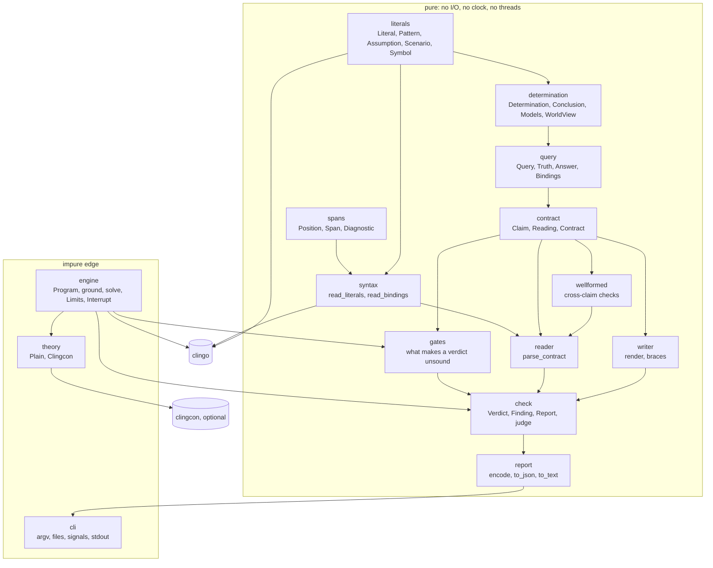
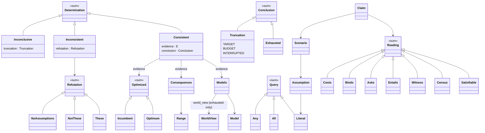

# elenctic 1.0 — the design of the successor to elenctic 0.3

> **Mission.** The gap that we need to fill is to have a best in class (industry exceptional
> standard) debugging and analysis and testing tool for ASP.
>
> **Goal.** Provide a best in class, mission critical system for ASP testing that dramatically
> exceeds what potassco provides.
>
> **Second aim.** elenctic should be a best in class exemplar of a Python project in that genre:
> code, structure, packaging, tests and docs that others in the field would point to as the model.

2026-10-30. The name is **decided: elenctic**, in a new repository under the same name (§11). The
working codename `aspnext` was used while building and is gone from the tree. "elenctic 0.3" below
means the existing library; unqualified "elenctic" is this one. Everything here was built and
measured on a Linux machine; §16 lists what was not checked.

**Revision, 2026-10-30 (speed, bugs, clingcon).** A search is 2.3 times faster (§16.1); `Program.read`
accepts any path-like; an undefined theory atom is elenctic's own fault; clingcon is built (§8; D11 built,
D12 resolved), as an optional extra, chosen by an in-program annotation and not a flag (§9). Record of
the changes: `CHANGELOG.md`.

## 1. Goals

### 1.1 Three pillars

The mission has three parts. All three are built on the same primitives (§2.3), so a gain in one
is a gain in the others.

| Pillar | What it is | Delivered by group 1 | Later |
|---|---|---|---|
| **Testing** | Contracts: claims about a program's answer sets, judged with a verdict and its evidence. The primary, always-present use | `@expect`, `@count`, `@model`, `@cautious`, `@brave`, `@query` (all three-valued), `@cost`, `@count optimal`; the optimal-set forms `@model optimal` (alias `@optimal { L }`), `@cautious optimal`, `@brave optimal`; `assuming { … }` on any claim; `where` and `@assign` under clingcon (§8); native cautious/brave (no enumeration); soundness gates that turn silent unsoundness into faults | corpus layout and discovery, `--isolate`, clingcon bounds (§8.6) |
| **Debugging** | Why does a claim fail; why is there no answer set | Minimal unsatisfiable cores over assumptions (`These`), the minimal refutation reported on every `no answer set` failure; `NotThese` and `NoAssumptions` as distinct values | Derivation and support data with rule spans, why-not by assumptions, 4-port tracing and spy points (§2.3, §4.3) |
| **Analysis** | What is true across, or best among, the answer sets | Cautious and brave consequences with their `Range` (all of AS(P) or only the optimal sets); optimal enumeration; cost vectors and proven optima as values | Optimization-level ledger, counterfactual pins with evidence, interference diagnosis (§2.3) |

### 1.2 Unit testing is the primary use

Contract-based unit testing is the primary, always-present use: `@expect`, `@count`, `@model`,
`@cautious`, `@brave`, `@query`, `@cost` and optimal-set claims in the program's own comments, corpus runs,
CI exit codes (`CLAIMS_HOLD` 0, `CLAIM_UNMET` 1 for a failed or undecided claim, `FAULT` 2) and pass/fail reports. Debugging, analysis and
the interactive client (§2.3) are built on the same typed primitives and never replace it.

### 1.3 Mission-critical properties

A testing tool is only worth running if its verdicts can be trusted. These properties drive the
design, and group 1 was held to them.

| Property | How it is enforced | Evidence | Gap |
|---|---|---|---|
| Every verdict is sound | `judge` is a pure function of the claim and a typed search outcome. `Inconsistent` is derived from "no model and exhausted", never from clingo's `unsatisfiable` flag. `Optimum` is built only from a proven optimum, `Incumbent` otherwise. Programs the checker would misread are a `Fault`, not a verdict: theory atoms (clingo would ground them and ignore their constraints), an objective that grounds away, a contrary read off shown atoms that the program derives and does not show | tests per rule; differential run (§12); hypothesis property that the optimum is the least cost among all models | `Optimum` does not structurally forbid construction by a caller (documented) |
| No false PASS under budget | A claim over a truncated search is `undecided`, never `pass`. A found witness is sound under truncation; a found counter-model refutes under truncation; nothing else is decided by a partial search | `tests/test_check.py`; the truncation tests for each reading | trusts clingo's own "exhausted" bit |
| Determinism | A decided verdict is a function of AS(P) as a set (counts are of *distinct* shown answer sets), not of enumeration order. Order can change only *whether* a truncated search decides | differential seeds; set-based tests | `--parallel-mode`/threads not exercised: **unverified** |
| Isolation | Not built. Untrusted programs can crash or exhaust the process (#11, #13, #14) | the 100,000-deep term segfault is reproduced with plain clingo (§5) | D5, opt-in `--isolate` (M1) |
| Reproducibility | JSON schema 1 is derived from the result types; spans are half-open and one-based; budgets are explicit parameters | `tests/test_report.py` | the clingo version is not yet recorded in the report: lean to add it with the schema bump |

### 1.4 Goals of the library

1. A **library first**: a pure, typed API with no printing, no global caps, budgets as parameters,
   source spans on everything a user wrote, results as data, and cancellable searches.
2. A **thin command line** over it, whose JSON is derived from the result types (§7.5).
3. **Serves clients that live elsewhere**: the CLI is a thin client; an LSP server, anakrisis, a
   REPL and other tools are their own projects that depend on this library (§2, §4).
4. Names that make correctness obvious to an ASP expert: the register of themelios's query and solve
   layers (§14).
5. Lean code. In-code documentation says what a thing is; history lives in the changelog.
6. Standards: PEP 621/735, `py.typed`, `mypy --strict`, `ruff` with `select = ["ALL"]`, pytest and
   hypothesis, Diátaxis docs, semver, Keep a Changelog, MIT.
7. Installable through uv, pixi and conda-forge; PyPI-ready metadata.

### 1.5 The exemplar bar

"Best in class exemplar of a Python project in that genre" is held to a checklist, so it can be
measured instead of asserted. The right-hand column is the honest state.

| Area | Bar | State |
|---|---|---|
| Code | Python 3.14, full annotations, `mypy --strict`, `ruff select=ALL`, pure functions, sum types by `match`, class hierarchy from the domain ontology, lean docstrings | green; comment+docstring ratio in §16 |
| Structure | Pure kernel, one impure engine, one impure CLI; layers as in §7.1 | stated and enforced: the import-linter contracts in `pyproject.toml` run in `pixi run check` and CI (§7.1) |
| Packaging | PEP 621/735, hatchling, `py.typed`, uv + pixi + conda-forge recipe, PyPI-ready | built; macOS/Windows, PyPI and a conda-forge submission **unverified** |
| Tests | pytest + hypothesis; properties against an independent oracle; differential against elenctic 0.3; mutation score with equivalent survivors listed; CRAP below 10 | §16 |
| Docs | Diátaxis: tutorial, how-to, reference, explanation; every claim kind shown with real output | skeleton plus group-1 additions; no generated API reference, no doctested examples yet |
| Release hygiene | semver, Keep a Changelog, CI on every gate | CI written; an outside review on 2026-10-31 reports two GitHub runs, the first failing and the second passing; not re-checked here |
| Independent checks | a second type checker, runtime checking, import contracts, dead code, dependency audit | queued as the external harness (§16.2); nothing added to the repo's own dependencies |


## 2. Scope and vision

### 2.1 What elenctic is

elenctic is almost, but not quite, what themelios attempts for Rust: a library for **testing,
verification and inquiry**, not for hosting a solver. Its eventual shape is *that which enables us
to inquire about ASP programs*.

It borrows themelios's vocabulary (§14) and its outcome rigor: every question returns a typed
outcome that says what was established and how firmly (`Determination`, `Conclusion`,
`Truncation`), and nothing is reported as settled that a bounded search left open.

| In scope | Out of scope |
|---|---|
| Claims and verdicts, with spans | Incremental grounding control, multi-shot step schedules |
| Firmness: exhausted, truncated by target, by budget, or interrupted; no false PASS under budget | Propagator plumbing and theory-propagator hosting |
| Reproducibility: explicit budgets, versioned JSON, spans | A solver front end that replaces `clingo` |
| Isolation of a checked program from the checker (D5, later) | Visualization (clingraph, viasp), UI generation (clinguin) |
| Evidence: witnesses, minimal cores, proven optima, and later proof runs and derivations | Encoding rewriting and optimization of programs |

### 2.2 The three clients it must carry

The library must be able to **host** the following without modifying the user's program. None is
built; each is listed so group 1 does not preclude it (§4.3 names the primitives).

1. **An ideal xclingo2, informed by Prolog debugging.** Prolog's four-port box model (Call, Exit,
   Redo, Fail), spy points, Shapiro's declarative and algorithmic debugging, and the why / why-not
   questions of a Prolog toplevel, applied to ASP derivations. *Sources: this paragraph is from
   memory; I have not read xclingo2, Shapiro's thesis, or a Prolog manual for this document.*
2. **What anakrisis attempts**: optimization-interference diagnosis, counterfactual pins, and
   cautious/brave claims with evidence (§2.4, D9).
3. **A REPL** in the manner of a Prolog toplevel or a Scheme/Racket REPL: `?-` queries over answer
   sets; cautious, brave, why and why-not at the prompt; assert and retract on a live control;
   spy points and 4-port tracing; rich values at the prompt; a module per program; history and
   replay. anakrisis's planned M3 session REPL overlaps this one; which of the two owns it is part
   of D9.

### 2.3 Primitives these clients need

"Built (G1)" means present in the tree now, tested; "Later" is neither built nor designed beyond
this row.

| Primitive | xclingo2-ideal | anakrisis | REPL | State |
|---|---|---|---|---|
| Typed outcomes with firmness | ✓ | ✓ | ✓ | Built (G1): `Determination`, `Conclusion`, `Truncation` |
| Answer sets as values (atoms, shown atoms, cost, theory assignment) | ✓ | ✓ | ✓ | Built (G1): `Model` |
| Queries under assumptions on one grounded program (re-query without re-grounding) | ✓ | ✓ | ✓ | Built (G1): `Grounded.solve/consequences/optimize(scenario)` |
| Cancellation and budgets | ✓ | ✓ | ✓ | Built: `Interrupt`, `Limits` |
| Minimal cores; why-not via assumptions | ✓ | ✓ | ✓ | Built (G1): `These`, `NotThese`, `NoAssumptions` |
| Cautious and brave consequences, whole or optimal range | | ✓ | ✓ | Built (G1): `Grounded.consequences`, `Range` |
| Optimization levels: cost vectors, proven optimum, optimal enumeration | | ✓ | ✓ | Built (G1): `Cost`, `Optimum`, `Incumbent`, `Optimized` |
| Pins: an assumption fixed for a search | | ✓ | ✓ | Built: `Assumption`, `Scenario` |
| Serialization of every value | ✓ | ✓ | ✓ | Built: JSON schema 1 |
| Spans on rules, atoms and derivations (not only claims) | ✓ | | ✓ | Later: needs a map from ground rules to source rules; clingo's ground-rule observer reports no source location (checked in clingo 5.8.2: `Observer.rule` receives `choice`, `head` and `body` only) |
| Derivation / support data per atom in a model | ✓ | ✓ | ✓ | Later |
| An optimization ledger: per-level cost under each pin, interference | | ✓ | | Later (candidate to migrate from anakrisis, D9) |
| 4-port events (Call/Exit/Redo/Fail) and spy points | ✓ | | ✓ | Later: ASP has no resolution order, so the events must be defined over derivations or a meta-interpreter; this is a design problem, not plumbing |
| Add and retract rules on a live control (assert/retract) | | | ✓ | Later: `#external` and `release_external`, or regrounding |
| A module/namespace per program; history and replay | | | ✓ | Later: `Program` and `Grounded` are values, so a namespace is a mapping of them |

What the group-1 API does not preclude: `Grounded` holds one control and is re-queried by
`Scenario`, results are immutable values, and the CLI is a client of the same functions (§7.5).
A live, mutable session would be a new type beside `Grounded`, not a change to it. One search at a
time per `Grounded` is the intended use; this is **not enforced and not tested**.

### 2.4 The relation to anakrisis

anakrisis is the one known consumer (pinned to elenctic 0.3.1) and attempts part of what this
library may host. The relation is open (D9): consumer, test bed that feeds elenctic, or a hybrid in
which mature primitives migrate here and anakrisis stays a client.

## 3. Against potassco's tooling

Primary sources read for this section, all read locally from the potassco repositories or fetched on
2026-10-30: the clintest repository at `aaef8c4` (README, `outcome.py`, `solver.py`, `test.py`,
`quantifier.py`, `assertion.py`, the guide pages on building and debugging tests); the clingo
repository's test layout (`app/clingo/tests/run.py`, `core1.lp/.sol`, the file list of
`libpyclingo/clingo/tests` and `libclingo/tests`, from the GitHub tree API); clingox 1.2.1 (the
wheel's module list and `testing/ast.py`); clingo-explaid (`README.md`, `LIMITATIONS.md`,
`unsat/computer.py`'s `mus`); and the README openings of asplain, clingraph, clinguin, clorm,
fclingo, telingo, viasp, clingo-dl, clingo-lpx, clingo-rs, musclingo, typclingo, xpit, meta-tools
and anthem-cx. **Not read beyond a repository description**: clasp, asprin, anthem, aspen-tree,
metasp, ngo, clingo-server, eclingo, clingo-time-machine (an empty repository when cloned), and
every potassco source file not named above. A tool I did not read may do what I say none does.

| Tool (what I read) | What it offers for testing, debugging or analysis | Against elenctic |
|---|---|---|
| **clintest** (sources and guide) | A Python test framework: tests are Python objects (`Assert(quantifier, assertion)`, `And`, `Or`, `Not`), run over a live clingo solve with early stop. Quantifiers `All`, `Any`, `First`, `Last`, `Exact`, `Less`…; assertions `Contains`, `Equals`, `SubsetOf`, `SupersetOf`, `Optimal` (proven optimality of a model). A four-valued `Outcome`: possibly or certainly true or false. `Record` shows the solver callbacks a test saw | See §3.1. Tests live in Python, not in the program; no source spans; no cautious/brave consequences, cores, costs or optimal sets as claims; no budget or interrupt parameter in the solver wrapper (clingo options can be passed through); no application (its `__main__.py` says there is none) |
| **clingo's own tests** | Golden output: `.lp` plus `.sol` expected output compared by `run.py`; embedded scripts that `assert`; unit tests in `libpyclingo/clingo/tests` and C++ in `libclingo/tests` | Regression of the solver, not a test facility for a user's program |
| **clingox** (module list; `testing/ast.py`) | AST helpers, reification, a program/backend/theory toolkit; `testing` has only AST test helpers (`ASTTestCase`, `parse_statement/literal/term`) | Nothing for testing answer sets |
| **clingo-explaid** (README, limitations, `mus`) | Unsatisfiability: `SubsetComputer` with `mus`, `mss`, `mcs`; facts-to-assumptions preprocessing; unsat constraints with locations. A `timeout` that returns an unsatisfiable (non-minimal) subset instead of a minimal one, in the same call as invalid input. Its own `LIMITATIONS.md` calls the meta-encoding approach not fully functional | Cores are the one area where it is ahead in breadth (`mss`, `mcs`, enumeration of several MUSes). elenctic returns a typed minimality flag, takes `Interrupt`, and names which of three refutation cases occurred |
| **musclingo**, **asplain**, **viasp**, **xpit** (README openings, musclingo docs index) | MUS algorithms; contrastive explanations by abduction; derivation visualization; an explanation architecture | Explanation and visualization are what the debugging and analysis pillars will host (§2.3); none is a test facility |
| **typclingo** (README) | A prototype type checker for programs | Static; a possible later `elenctic` check, not a competitor |
| **anthem-cx** (README) | Counterexamples for equivalence of two programs given a user guide | Equivalence checking; a possible later claim kind |
| clingraph, clinguin, clorm, fclingo, telingo, clingo-dl, clingo-lpx, clingo-rs (README openings) | Visualization, UI, ORM, solver extensions, bindings | Not testing tools; clorm and the extensions are things elenctic's values must interoperate with (clingcon is §8) |

### 3.1 Where elenctic must exceed them

Not claims already achieved; each is a place the evidence above says elenctic has to win to meet
the goal, and where it has, what the evidence is.

1. **Verdicts that cannot be falsely positive under a budget.** In clintest, `Assert.on_finish`
   wraps the quantifier in `Finished` whatever the `SolveResult` was (read in `test.py`), and the
   guide states that without `"0"` clingo stops after the first model. So the answer for a
   universal claim over a program run with the default is certain after one model. In elenctic a
   truncated search yields `undecided`. The experiment in §3.2 measures this.
2. **Claims live with the program.** Contracts are comments in the `.lp`; no Python harness is
   required, and the same file serves as test, documentation and CI input.
3. **Evidence as values with spans.** A failure carries the minimal core, the missing literals, the
   optimum, in typed form, with the claim's source span. clintest's evidence is a recording of
   solver callbacks.
4. **Consequences, optimal sets and costs as first-class claims** (`@cautious`, `@brave`,
   `@model optimal`, `@cost`), routed to clingo's native cautious/brave and `optN`, rather than
   asserted model by model.
5. **A CLI with stable exit codes and a versioned JSON schema** for CI. clintest ships no
   application.
6. **Faults for programs the checker would misread**: theory atoms, absent objectives,
   unshown contraries.
7. **Where elenctic is behind**: clintest streams and stops the solver the moment an outcome is
   certain (elenctic enumerates a bounded set and judges it, except for native consequences);
   clingo-explaid enumerates several MUSes and has MSS/MCS; neither is built here.

### 3.2 Experiment: the default-budget footgun

Program `1 { a; b } 1.`: exactly one of `a`, `b` holds, so `a` is not in every answer set. The
claim is "every answer set contains `a`". clintest `aaef8c4` was installed from the clone into a
scratch environment and run with clingo 5.8.2; elenctic ran the same program through its CLI.

| Run | Result |
|---|---|
| clintest, `Clingo([], "1 { a; b } 1.")`, `Assert(All(), Contains("a"))` | `T!`: *certainly true* (wrong) |
| clintest, `Clingo(["0"], …)`, same test | `F!`: certainly false |
| elenctic, `--models 1`, `@query yes { a }` | `UNDECIDED` (`search ended: target`) |
| elenctic, default limits, `@query yes { a }` | `FAIL` (`yes expected, answer is unknown`) |

The clintest guide documents that without `"0"` clingo stops after the first model; the finding is
that the outcome is then reported as certain, not that the guide is silent. It is a footgun, not a
bug in a claim of its own: the framework is doing what its `on_finish` says. Scratch copies:
`footgun.lp` and `x.py` (probe files, not kept in the repository). One program, one
claim: this measures the mechanism, not how often it bites.

A boundary on the elenctic side, found while running it: with `--models 1`, a `@cautious { a }`
claim sharing a group with enumerating claims is `UNDECIDED`, not decided natively, because native
routing is used only when a group holds nothing but cautious/brave claims (D7). That is sound and
conservative; routing such a claim natively whenever the shared enumeration truncates is a
refinement listed under D7.

## 4. Downstream consumers

### 4.1 What the library offers beyond the clingo, clingox and clingo-explaid APIs

The clingo Python API is a solver binding: a `Control`, a `SolveHandle`, integer literals, a
`SolveResult` with `satisfiable/unsatisfiable/exhausted/interrupted` flags, and `Model.cost`. The
points below are what a consumer gets from elenctic and would otherwise write.

| Offer | clingo / clingox / clingo-explaid | elenctic |
|---|---|---|
| Typed sum-type outcomes with firmness | Booleans on `SolveResult`; `unsatisfiable` can be raised by a cancelled search (observed in this project's engine, BUILD-LOG) | `Determination = Consistent \| Inconsistent \| Inconclusive`, `Conclusion = Exhausted \| Truncation(TARGET \| BUDGET \| INTERRUPTED)` |
| Verdicts as data, with spans | none | `Verdict`, `Finding`, `Report`, `Span` on every claim and diagnostic |
| Queries under assumptions | `solve(assumptions=…)` with integer literals; clingo-explaid's `AssumptionPreprocessor` rewrites facts | `Scenario` of `Assumption(Literal, holds)`; unsatisfiable → minimal core |
| Consequences, cores, optimal sets as values | `--enum-mode`, `on_core` integers, `--opt-mode` by option strings | `Consequences(mode, over)`, `Refutation`, `Optimized(Optimum \| Incumbent)` |
| Budgets and cancellation | `SolveHandle.cancel()`, options | `Limits(seconds, models)`, `Interrupt`, and a truncation that says which |
| Serialization | none | JSON schema 1, derived from the types |
| Stable versioned API | the clingo ABI | `elenctic.__all__`, semver, `tests/test_public.py` |

### 4.2 Consumers and what each needs

| Consumer | Needs | Gap today |
|---|---|---|
| CLI (`elenctic test`) | `check`, `to_text`, `to_json`, stable exit codes | none for `test`; other subcommands are reserved (§7.5) |
| Language server (its own project, later) | `check` with an `Interrupt` per request; spans | spans on rules and atoms (§2.3) |
| anakrisis | the query kernel, `solve`, optimal enumeration for its oracle, pins, cautious/brave with evidence | the oracle `Mode.OPTIMAL_ENUM` is now `Grounded.optimize` (G1); the ledger and justification trees are not here |
| CI | exit codes, JSON, deterministic budgets, no network | clingo version in the report (§1.3) |
| Notebooks | values with `repr`; no printing | rich display hooks: not built |
| REPL and debugger (§2.2) | the primitives of §2.3 | session, derivations, tracing |

### 4.3 Stability promise

Everything in `elenctic.__all__` follows semver once 1.0 is released; before that the changelog's
"Unreleased" section is the record. Nothing outside `__all__` is promised.

## 5. The review's weaknesses, and the issues

elenctic 0.3 has **no open issues** (19, all closed; the open-state query returned `[]`). The closed
issues #1–#14 are treated as regression constraints; #15–#19 are releases and docs.

### 5.1 Review weaknesses

| Weakness in elenctic 0.3 (review 2026-10-30) | In elenctic 1.0 | Evidence |
|---|---|---|
| Query kernel not in the public `__all__` | Kernel exported from the package: `Literal`, `Pattern`, `Query`, `Answer`, `answer`, `singleton_answer`, `bindings`, `world_view`, `solve`, `Assumption` | `tests/test_public.py` |
| ~40% of lines are comments and docstrings, with bug narratives | 7.7% (1 comment line, 144 docstring lines in 1,872 non-blank source lines) when first measured, 13.3% on 2026-10-31 (§16.1); elenctic 0.3 measured 42.3% with the same script | a script over the AST and the token stream, not kept |
| 8 control-layer functions over 60 lines | 0 over 60, 0 over 40 of 351 functions; longest 34 lines (2026-10-31) | AST count |
| `parse_query('yes','{ p("a=b") }')` raises | Literal lists are read by clingo's own parser, not split by hand; the case is a test | `test_contract.py:79` |
| Hand-rolled `_parse_goal` | Removed: `syntax.read_literals` / `read_bindings` use clingo's AST | `syntax.py` |
| Speculative `unify` | Removed: `Pattern.match` and `bindings` over a world view | `literals.py`, `query.py` |
| "Only impure module" overclaim | Stated honestly: `engine` (clingo control, threads, clock), `Program.read` and `cli` (files, signals, stdout) are impure; everything else is pure | §7.1 |
| Fixed `MODEL_CAP` of 1,000,000 and a fixed per-solve budget | `Limits(seconds, models)` per call; `--budget`, `--models` | `engine.py` |
| No assumptions form | `assuming { l, not l }` on any claim, and `Scenario` in the library; unsatisfied assumptions return a core | `contract.py`, `engine.py` |
| `#maximize` costs negated | Costs are clingo's minimized-sum normal form, and `@cost` over `#maximize` is accepted (D6, §6.4) | `tests/test_check.py` |
| Git-only distribution | uv wheel built and installed in a clean venv; pixi environment solved and `pixi run check` green; rattler-build conda package built, its import and `pip check` tests passed | §10 |
| ruff ISC004 drift | `ruff check` and `ruff format --check` clean over `src tests scripts`, in the gate | `pixi run check` |

### 5.2 Closed issues as regression constraints

| # | Title (abridged) | Status in elenctic 1.0 |
|---|---|---|
| 1 | Project the optimal class for shown-only optimal modes on theory solvers | Partly: optimal-set claims over clingo are built (G1: `@cautious optimal`, `@brave optimal`, `@model optimal`, `@count optimal`); theory solvers are reserved (§8) |
| 2 | Structured `--json` output | Done; derived from the result types |
| 3 | `elenctic <file.lp>` single-file invocation | Done: paths are files or directories |
| 4, 5 | `AS(P)` tags must mean all of `AS(P)` on optimizing programs | Done by law: `opt_mode=ignore`; a test enumerates both models of `{p}. #minimize { 1 : p }.` |
| 6 | Solve-time faults escape as tracebacks | `ground` returns `Fault`; `check` returns `Report \| Fault \| None`; nothing raises |
| 7, 9 | A non-exhaustive search reported as a complete enumeration | A `WorldView` can be built only from an exhausted search (`world_view` returns the `Truncation` otherwise); census, cautious, `@query` and bindings claims are `undecided` on a truncated search |
| 8 | Route escaping solver outcomes to their registers | `Determination = Consistent \| Inconsistent \| Inconclusive`, matched exhaustively |
| 10 | `@expect sat` UNDECIDED when the enumeration did not finish | A found model is a witness: `pass`, whatever the search did after it |
| 11 | Untrusted `.lp` cannot read past the corpus boundary | **Not addressed.** `Program.path` lets `#include` resolve beside the file; no corpus walk exists yet. M1 |
| 12 | One fault owner per region | `Locus.PROGRAM \| REQUEST` on every `Fault` |
| 13 | AST walk's recursion limit reachable from a `.lp` | No recursion over program text. **Measured:** terms nested 10,000 deep are fine; 100,000 deep segfaults inside clingo's own `parse_string` (reproduced with plain clingo, no elenctic). Containment needs a process per file (§13, D5) |
| 14 | Memory exhaustion costs the whole run | **Not addressed** (same remedy as 13) |


## 6. Semantics kept, and where they depart

Kept from elenctic 0.3: the contract format, the three verdicts, exit codes `CLAIMS_HOLD` 0, `CLAIM_UNMET` 1 and `FAULT` 2 (`INTERNAL_ERROR` 3 is new), the text report
shape, three-valued answers (Gelfond–Kahl Def. 2.2.2), `@count 0` against `@expect sat` being
ill-formed, `@expect unsat` admitting no model claim except `@count 0`. A **differential run** (§12)
found no disagreement on any claim both tools run.

### 6.1 The model-set law

Two sets of models are distinguished and never conflated. `opt_mode=ignore` yields AS(P), all
stable models, whatever the program minimizes; `opt_mode=optN` yields Opt(P), the optimal stable
models. A claim without `optimal` reads AS(P); a claim with `optimal` (a `Range.OPTIMAL`) reads
Opt(P). Consequences carry their `Range` so a cautious set over Opt(P) is never mistaken for one
over AS(P): `{ b } ⊆ ⋂ Opt(P)` and `⋂ AS(P)` are printed differently.

### 6.2 Claim kinds

| Claim | Holds when | Group |
|---|---|---|
| `@expect sat` / `unsat` | an answer set exists / none | 0 |
| `@count n` | exactly `n` distinct shown answer sets | 0 |
| `@model { L }` | some answer set shows exactly `L` | 0 |
| `@brave { L }` | `L` ⊆ ∪ AS(P) | 0 |
| `@cautious { L }` | `L` ⊆ ⋂ AS(P) | 0; native in G1 |
| `@query yes\|no\|unknown { Q }`, `… = { B }` | the three-valued answer / bindings | 0 |
| `@model optimal { L }` (alias `@optimal { L }`), `@cautious optimal { L }`, `@brave optimal { L }` | the same three over Opt(P): the optimum is proven, and some optimal answer set shows exactly `L` / `L` ⊆ ⋂ Opt(P) / `L` ⊆ ∪ Opt(P) | G1 |
| `@count optimal n` | exactly `n` distinct shown optimal answer sets | G1 |
| `@cost { c1 c2 … }` | the optimum's cost vector, highest priority first, is exactly this | G1 |
| any of the above `assuming { l, not l }` | judged over the answer sets satisfying the assumptions | 0 |

Several claims of the same kind in one contract are independent claims (D2).

### 6.3 Preconditions: a fault is better than a wrong verdict

A contract that would be misread is a `Fault` with `Locus.REQUEST` and a span, never a verdict.

| Condition | Why it is a fault |
|---|---|
| The program has theory atoms | clingo grounds them and ignores their constraints, so a verdict would be about a different program (0.3.1 has the same gate: it asks for `@elenctic solver clingcon`; §8) |
| An `optimal` or `@cost` claim over a program whose objective grounds away | no optimization happens; an optimum of "nothing" would be vacuous. Decided from the *ground* objective (an observer), so `#minimize { 1,a : a }.` over an `a` that never holds counts as none |
| `@count optimal N` with `N` greater than an explicit `@count M` | the optimal answer sets are among the answer sets |
| A `no`/`unknown` query or bindings claim that reads the contrary `-p/0` off the shown atoms when the program can derive `-p/0` and does not `#show` it | the answer would be "no" because the contrary was hidden, not because it does not hold |

### 6.4 The sign of costs (D6)

The cost of a model is the minimized sum per priority level, highest priority first, so a
`#maximize` level is negated: this is clingo's `Model.cost` and elenctic 0.3.1's internal form.
`@cost { -5 }` is the claim that the optimum of a `#maximize` is 5. Message: `(5) expected, optimum
is (-5)`. The normal form was chosen because it is what clingo reports and what a clingcon
objective will have to be compared against (§8); presenting natural values is a rendering that can
be added without changing a claim's meaning. See D6.

### 6.5 Departures (each a decision for you; §13)

- Several `@model` claims per contract are allowed, each an independent existential claim.
  elenctic 0.3 rejects a second one ("at most one @model per contract"); D2.
- `assuming { … }` is new.
- elenctic 0.3's collapsed `@count 0` row under `@expect unsat` is shown as two claims.
- `@cost` over a `#maximize` is accepted in the normal form of §6.4; elenctic 0.3.1 rejects it
  ("natural-value normalisation deferred").
- The contrary-shown precondition is **derivation-aware**: elenctic 0.3.1 faults whenever a
  `no`/`unknown` query's contrary is not shown; elenctic faults only when the program can derive
  that contrary. Strictly fewer faults, still sound. A flagged departure.
- An objective that grounds away is a `REQUEST` fault even when the program is unsatisfiable
  (0.3.1 says `fail`).
- `@assign`, `@assign optimal`, `where` and `@elenctic solver` are carried (§8); a theory objective
  (`&minimize`) is a fault rather than the rejection of an AS(P) reading (§8.3).
- Discovery/corpus layout and `--explain` are not yet carried.
- Cores are now minimal (deletion-based), not merely sufficient; a core cut short by a budget is
  reported as not minimal (`These(…, minimal=False)`).


## 7. Architecture

### 7.1 Layers



`check` calls `engine` for its searches; `judge` (claim, determination -> finding) is pure and is
where verdict logic lives. The layering and the clingo boundary are contracts, in `[tool.importlinter]` of `pyproject.toml`,
checked by `lint-imports` in the gate and in CI. The first form of the clingo contract (written in the
quality harness, §16.2) said that only
`literals` (the term vocabulary, which re-exports `Symbol`), `syntax` (the parser), `theory` (its
registration) and `engine` (the solver) import clingo. The tree grew past that: measured on 2026-10-31
with `git grep`, sixteen modules do: `body`, `classes`, `engine`, `facts`, `grounded`, `literals`, `matching`,
`normalize`, `patterns`, `relation`, `rows`, `search`, `syntax`, `terms`, `theory` and `tree`. The
modules that build and read the clingo AST and symbols use it directly; `check`, `judge`,
`contract`, `determination`, `query`, `report` and `cli` do not. The contract was narrowed to that
boundary, not the tree bent back to the first form, which would have moved a dozen modules behind
`literals` and `syntax`. It names the sixteen as the only importers of clingo, so a new module that
imports clingo fails the gate until it is added on purpose. Only `theory` imports clingcon, lazily;
`spans` imports nothing outside the standard library; no module reaches up: `layers` orders the
modules, with `traversal` under `tree`, and `display`, a leaf, beside `literals`. The “pure” label means no I/O or clock, not
no solver types: `literals` and `syntax` call clingo's term and AST parsers.

### 7.2 The ontology

Types are designed from is-a relations of the domain; sum types are `type X = A | B` aliases,
dispatch is `match`.



Facts the shapes carry, so no comment need: `Models` has a `first` model (a consistent search has
one); `WorldView` refuses an empty set; `Inconsistent` is derived from "no model and exhausted", never
from clingo's `unsatisfiable` flag (which a cancelled search can also raise); `Limits` refuses
negative numbers.

Verdict logic is two functions: existential (`found` → pass; else fail if closed; else undecided)
and universal (`refuted` → fail; else pass if closed; else undecided). Each reading is one of them,
or a small combination (`Census`).

### 7.3 Public API (excerpt)

```python
from elenctic import Limits, Program, check, solve, Literal, Assumption

report = check(Program.read(path), limits=Limits(seconds=10, models=10_000))
found = solve(program, scenario=frozenset({Assumption(Literal.parse("p"), holds=True)}))
```

- `check(program, *, limits, interrupt) -> Report | Fault | None`; `None` means no contract.
- `solve(...) -> Determination[Models] | Fault`; `Grounded.consequences(mode, ...)` for native
  cautious/brave over shown atoms; `Grounded.optimize(...)` for the optimum, its cost and every
  optimal model.
- `Interrupt().pull()` from any thread ends a search with `Truncation.INTERRUPTED`.
- All public names are in `elenctic.__all__`; results are frozen, slotted dataclasses.

### 7.4 Clients

The library serves clients; each lives in its own project and depends on it.

| Client | Where | Uses |
|---|---|---|
| Command line | this repo, `cli.py` (118 lines) | `check`, `Run`, `to_text`, `to_json` |
| A language server | its own project, later | `check` with an `Interrupt` per request; `Span` for ranges |
| A REPL, a debugger, an xclingo2-like tool | their own projects, later (§2.2) | the primitives of §2.3 |
| anakrisis | its own project | the query kernel, `solve`, `Literal` (§13) |
| Other tools | their own projects | whatever of the public API they need |

What makes the library usable from a long-running client, with no code for any one of them here:

- **Results are data**: frozen dataclasses and sum types (`Determination`, `Report`, `Fault`), matched
  exhaustively; no client parses text.
- **Source spans on everything the user wrote**: `Span` is half-open and one-based, on every `Claim`
  and `Diagnostic`.
- **Faults are values**: `check` returns `Report | Fault | None` and does not raise on bad input.
- **Cancellable solves**: `Interrupt.pull()` from any thread ends a search with
  `Truncation.INTERRUPTED`; `Limits` bounds time and models per call.
- **No printing, no global state**: only `cli.py` writes to stdout.

The CLI is `argv → Run → text|JSON → exit code`. Real output:

```
$ elenctic bad.lp
bad.lp — FAIL
  [FAIL] @cautious { tea } (line 2): { tea } ⊆ ⋂ AS(P) = { biscuit } (missing: { tea })
  [FAIL] @model { biscuit, tea } assuming { coffee } (line 3): { biscuit, tea } shown by an answer set: no

0/1 passed, 1 fail
```

### 7.5 The command line: subcommands

The CLI is a thin client: `argv → library call → text or JSON → exit code`, one subcommand per
kind of inquiry. Only `test` is implemented; the others are reserved so that the grammar does not
change when they arrive.

| Command | Meaning | State |
|---|---|---|
| `elenctic test PATH…` (default) | check programs against the contracts in their comments; `--json`, `--verbose`, `--budget N\|all`, `--models N\|all` (a positive number or `all`, never 0; `all` is no limit) | built |
| `elenctic repl` | an interactive session over a live program (§2.2) | reserved |
| `elenctic why` | the support of an atom in an answer set, or why it is absent | reserved |
| `elenctic ask` | one query, answered over the answer sets | reserved |
| `elenctic explain` | the evidence behind a verdict | reserved |

- With no command, the arguments are taken as paths: `elenctic drinks.lp` is `elenctic test
  drinks.lp`. A path named `test`, `repl`, `why`, `ask` or `explain` must be written `./why`; this is
  the one ambiguity of a default command.
- A reserved command writes ``elenctic: `why` is reserved and not yet built`` on stderr and exits `FAULT`.
- Limits per search: `--budget` is a positive number of seconds (fractions allowed), 30 by default;
  `--models` is a positive integer, 100,000 by default (`DEFAULT_MODEL_CAP`); either takes `all` for
  no limit, and zero or a negative value is a usage error. The cap is a command-line default only, so
  that a program with a huge number of answer sets cannot exhaust memory unasked; a search that reaches
  it is `undecided`. The library keeps `Limit.UNBOUNDED` as its default, since a call there states its own
  limits (§1.4).
- Exit codes are stable and part of the contract with CI. They are the members of `Exit`, an
  `IntEnum` in `report.py`, and code names them, never the numbers: **`CLAIMS_HOLD`** (0) every claim
  passed, **`CLAIM_UNMET`** (1) some claim failed or was undecided, **`FAULT`** (2) some file could
  not be checked (a `Fault`) or the command was refused, **`INTERNAL_ERROR`** (3) elenctic itself
  failed: an exception no check anticipated, reported as one line on stderr with no traceback.
  `INTERNAL_ERROR` is distinct so that a bug in elenctic is never read as a failed claim; 0.3.1 also
  has a fourth code.

Real output of the claim kinds of group 1 is in `docs/reference/reference.md`, regenerated by
`scripts/capture_examples.py` from the corpus in `docs/examples/`.

### 7.6 JSON

`encode` is structural: a dataclass becomes `{"kind": TypeName, field: …}`; enums by value;
frozensets sorted; a class object raises `TypeError`. Top level `{"schema": 1, "run": …,
"exit_code": n}`. The schema is a consequence of the types, not a second definition.


## 8. Theory extensions: clingcon

**Rule.** Group 1 was designed with clingcon in mind; the clingcon pass (M2, 2026-10-30) built it
on those types. §8.3 is what is built; §8.4 is what is not; §8.5 is how it was checked.

### 8.1 What elenctic 0.3.1 does

Read from a local clone of elenctic 0.3 at `944a8ce` (tag v0.3.1 at `07a249d`): a solver registry
`SOLVERS = {clingo, clingcon}` (`registry.py`), with clingcon the only solver that interprets
theory atoms; `@assign` and `@assign optimal` claims over integer assignments; the `theory` extra
(`clingcon>=5.2.1`); a discovery-time fault when a program has theory atoms but no declared
theory solver, with the reason "a wrong PASS" (`discovery.py`); projection decisions for clingcon
in `solvers.py`; rejection of an AS(P) reading over a theory-native objective.

### 8.2 Probes (measured 2026-10-30, clingcon 5.2.1.post2, clingo 5.8.2)

| Probe | Result | Consequence for the design |
|---|---|---|
| `&dom{0..3}=x. &dom{0..3}=y. &sum{x;y}=3. #show.` enumerated | 4 models; every one has the **same empty shown atom set**; they differ only in assignment: (x,y) = (2,1), (1,2), (0,3), (3,0) | Counting "distinct shown answer sets" would report 1, not 4. With clingcon the identity of an answer is (shown atoms, assignment). `Model.assignment` is already a separate component for this reason |
| `&minimize{x+y}` over `&sum{x;y} >= 4` | one model, x=0, y=4; `Model.cost == []`; `optimality_proven` false | clingo's cost vector and proof flag do not see a theory objective |
| the same under `--opt-mode=ignore` and `optN` | the identical single model | the theory objective is driven by the propagator and cannot be switched off. The model-set law (§6.1) cannot be applied to it by an option |
| `{a}. &sum{x} >= 4 :- a. &sum{x} <= 1 :- not a.` with `#minimize{1:a}`, `opt-mode=ignore` | 4 models: `a` false with x = 0, 1; `a` true with x = 4, 5 | clingo's own `#minimize` still obeys `ignore` beside clingcon |
| `--enum-mode=cautious` with clingcon | one model; its atoms are the cautious atoms; its assignment is one assignment, not a consequence | cautious/brave are well defined over atoms; an assignment must never be reported as a consequence |
| unsatisfiable programs with assumptions | cores are returned and can be shrunk by deletion (probed earlier in this work) | `These`/`NotThese`/`NoAssumptions` carry over unchanged |

### 8.3 What is built

**Choosing the solver.** A contract says `% @elenctic solver clingo` (the default) or
`% @elenctic solver clingcon`, in the program's own comments. There is no flag (§9): the choice
belongs to the program, which cannot be checked correctly under the other solver. `Contract.solver`
is a `Solver` (`StrEnum`); the engine maps it to a `Theory` (`theory.py`: `Plain`, which adds each
statement as written, and `Clingcon`). `theory.py` is the only module that imports `clingcon`
(an import-linter contract in `pyproject.toml` keeps it so); the import is lazy and its absence is `None`.

**Optional dependency.** clingcon is the extra `elenctic[theory]` and the pixi environment
`theory`. A contract that declares clingcon where it is absent is a `REQUEST` `Fault` at the
declaration: ``the contract declares `% @elenctic solver clingcon`, which is not installed; install
`elenctic[theory]`, or use the pixi `theory` environment``. Plain clingo users never import it.

**Types.**

| Type | Over clingo | Over clingcon |
|---|---|---|
| `Valuation(variable, value)` | not produced | one variable of the program (a term) and its integer |
| `Assignment` | not produced | `frozenset[Valuation]`: the integer assignment of one model (D12: used, not removed) |
| `Model` | atoms, shown atoms, cost | + `assignment`; `identity = (shown, assignment)` |
| `Solver` | `CLINGO` | `CLINGCON` |
| `Assigns(assignment, over)` | gated off | `@assign [optimal] { x=1, … }`: some answer set (of `over`) assigns each variable that integer |
| `Witness(literals, over, assignment)` | `assignment` is empty | `@model { L } where { x=1, … }`: the same answer set shows exactly `L` and assigns those |
| `Determination`, `Refutation`, `Limits`, `Interrupt`, `Range` | | unchanged |

**Counting.** The identity of an answer under clingcon is (shown atoms, assignment), as probed in
§8.2: `&sum{x;y}=3` has four answers and one shown set. `@count n` counts distinct identities and
its detail says so: `4 expected, 1 distinct shown answer sets with their assignments`. Under clingo
the assignment is empty, so nothing changes. No projection is applied to the search: enumeration
is by clingo's own model enumeration, and the 41 clingcon twins of the corpus take 0.59 s in all (median of 5, in process), so a projection would add a semantics to be argued for no measured gain.

**Consequences and cores.** Cautious and brave stay sets of shown atoms, computed natively; an
assignment is never reported as a consequence. Assumption cores are over atoms and shrink by
deletion with the propagator registered.

**Faults (a theory is a precondition, as in §6.3).**

- theory atoms without `% @elenctic solver clingcon`: clingo would ground and ignore them;
- a theory atom whose theory is not declared: elenctic's own message and location, not clingo's;
- a theory objective (`&minimize`) under any claim: clingcon applies it in every search and
  clingo's cost does not see it (§8.2, rows 2-3), so the model-set law (§6.1) cannot be applied;
  the fault says to state the objective with `#minimize`/`#maximize`;
- `@assign` or `where` under clingo: there is no assignment to read.

**Optimization beside a theory.** clingo's own `#minimize`/`#maximize` still obey the model-set
law with clingcon registered (§8.2, row 3); `@assign optimal` and `@model optimal … where` range
over the optimal answer sets so found, each carrying its assignment.

### 8.4 What is not built

| Not built | Why |
|---|---|
| `@bounds`, the least and greatest value of a variable over the answer sets | a different claim and a different value, never an atom set (reserved name) |
| A cost source for a theory objective, and optimal enumeration over it | the objective is invisible to clingo's cost; it is a fault for now |
| `&maximize` | not probed |
| Projection | not needed (§8.3, Counting) |

### 8.5 How it was checked

- **kr-domains**: 135 programs (94 clingo, 41 clingcon twins), copied read only from the kr-domains
  collection into a scratch directory: all 135 pass, `CLAIMS_HOLD` (0) under `elenctic test`;
  `scenarios` alone 125 of 125, `standalone` alone 10 of 10, a sub-directory 25 of 25.
- **Against 0.3.1, claim by claim**: 412 claims, 0 verdict differences, and the same 135 files.
- **Negative differential**: 90 mutants (a `@count`, `@cost` or `@expect` made wrong) over the
  clingcon twins, one per file per round, run through both: 0 differences, so the two agree on
  *failing* as well as passing.
- Unit tests (`tests/test_clingcon.py`, `tests/test_theory.py`) for each rule above, and a worked
  example with its real output (`docs/examples/clingcon.lp`).

### 8.6 What is unverified

- The wheel: the brief expected the PyPI `clingcon` wheel to fail on Python 3.14. On this box
  `clingcon 5.2.1.post2` installs from PyPI on 3.14.10 and works; conda-forge builds 5.2.1 for
  Python 3.15 only, so pixi resolves 3.15.2. Not run: macOS, Windows, other Linux distributions.
- Thread-safety of the propagator; `&maximize`; the time of core shrinking on large theory programs.
- The differential covers 41 programs from one corpus; its generator (`scripts/differential.py`)
  draws plain ASP and cannot reach clingcon.


## 9. Standards and packaging

| Item | State |
|---|---|
| `pyproject.toml` PEP 621 + `[dependency-groups]` (PEP 735), hatchling, `py.typed`, MIT, `license-files` | done |
| `mypy --strict` plus extra error codes, `warn_unreachable` | clean; 34 files at the clingcon pass, 77 on 2026-10-31 (src, tests, scripts) |
| `ruff` `select = ["ALL"]` (a short ignore list for docstring rules and formatter conflicts), `ruff format` | clean |
| pytest + hypothesis | 312 tests with clingcon installed at the clingcon pass, 494 on 2026-10-31; without it `tests/test_clingcon.py` and the clingcon example tests skip |
| Optional dependency | `elenctic[theory]` (clingcon `>=5.2.1,<5.3`) and the pixi `theory` environment; not in the `dev` group, which pixi would re-solve and fail on | done; `uv tool install '.[theory]'` on 3.14 and `pixi install --locked -e theory` (3.15.2) both run all 135 |
| Python | `>=3.14` (PEP 695 generics and aliases, `match`, `StrEnum`, slotted frozen dataclasses, `NamedTuple`) |
| Docs | Diátaxis skeleton: tutorial, how-to, reference, explanation (`docs/`) |
| Changelog | Keep a Changelog; semver; version 0.0.0 |
| CI | `.github/workflows/ci.yml` (the gate is `pixi run -e theory check`, which is the one documented gate and what `check.sh` runs; a secondary uv job syncs the tracked `uv.lock` on Linux and macOS and runs the tests; rattler-build); an outside review on 2026-10-31 reports two GitHub runs, the first failing and the second passing; not re-checked here |

**Rule for the command line (Gregory, 2026-10-30).** Keep the flags a minimal set that composes. A
flag is introduced only together with the feature that needs it, and 0.3.1's flags are never
restored one for one. This pass adds none: the clingcon solver is chosen by the in-program
annotation `% @elenctic solver clingcon`, not by `--solver`. The flags that exist are the four of
§7.5 (`--json`, `--verbose`, `--budget`, `--models`).

**Proposal: a minimal composable flag set**, each flag arriving with the feature that needs it. Each
is orthogonal to the others and to the contract text, and none changes what a claim means.

| Flag | Introduced with | Why it cannot be an annotation |
|---|---|---|
| `--isolate` | M1 isolation: a process per file with a memory limit (D5, §5 #11/#13/#14) | where a program runs is a property of the run, not of the program |
| `--select GLOB` (repeatable) | M1 corpus layout and discovery, to run part of a corpus | which files to run belongs to the invocation |
| `--explain` | M3 `explain`, evidence beside a verdict | how much to print is a property of the reader; or it becomes `elenctic explain` and needs no flag |
| `--parallel N` | a run of many files, when measured to pay | a resource limit of the machine |
| `--seed N` | any randomized search or generated case the library introduces | reproducibility of a run |
| `--format json\|text` | when a third output form exists; `--json` stays until then | a rendering of the run |

Not proposed: `--solver` (the annotation does it), a flag per 0.3.1 option, or any flag that changes
a verdict. A flag that would change a verdict belongs in the contract, where it is reviewed with the
claims.


## 10. Distribution

- **uv / PyPI**: `uv build` produced an sdist and wheel; the wheel installed into a clean venv and
  `elenctic --help` ran. PyPI upload not done (and not to be done without you).
- **pixi**: `[tool.pixi.*]` in `pyproject.toml` (pixi 0.83.0 from the GitHub release; sha256 matched).
  `pixi install` solved from conda-forge; `pixi run check` ran the whole gate green; `pixi.lock`
  committed. Platforms listed: linux-64, osx-arm64, osx-64, win-64; **only linux-64 was solved here**.
- **conda-forge**: `recipe/recipe.yaml` (rattler-build 0.80.0, `noarch: python`). `rattler-build build`
  produced `elenctic-0.0.0-….conda`; its python-imports test and `pip check` passed. A staged-recipes
  submission needs a real source URL and sha256 (the recipe builds from `path: ..`) and a public
  repository, so it is **unverified as a conda-forge submission**.


## 11. Naming and lineage

Register: Greek abstract nouns for an activity, as in themelios (foundation) and zetesis (inquiry).
The library's own contribution is *checking a program against what it must satisfy*.

Availability, checked 2026-10-30 against `https://pypi.org/pypi/<name>/json` and
`https://api.anaconda.org/package/conda-forge/<name>` (404 means free; availability can change):

| Candidate | Greek | Meaning | Fit | PyPI | conda-forge |
|---|---|---|---|---|---|
| **dokimasia** | δοκιμασία | the scrutiny an Athenian underwent before taking office; an assay or trial | A program qualifies for use by passing its tests; close to "contract check" | free | free |
| **peirasis** | πεῖρασις | trial, attempt, putting to the test | Short sense of "test"; weaker on "against a stated standard" | free | free |
| **apodeixis** | ἀπόδειξις | demonstration, proof | Over-claims: verdicts are checks of claims, not proofs | free | free |
| **exetasis** | ἐξέτασις | close examination, audit | Good for audit; clumsy to type | free | free |
| **elenctic** (chosen) | ἔλεγχος | refutation by cross-examination | Already his; the claims-as-challenges idea | free | free |
| *basanos* | βάσανος | touchstone | Best fit, **taken** on PyPI (an unrelated finance library) | taken | free |
| *elenchos*/*elenchus* | ἔλεγχος | the noun | **taken** on PyPI (a Nagios framework; a knowledge-base tool) | taken | free |

**Decided 2026-10-30: the name is `elenctic`.** It is free on PyPI and conda-forge, anakrisis already
depends on it, and Gregory likes its sound and the history of the term.

**Lineage, decided 2026-10-30:** a **new repository under the same name**, created only once the
open items are addressed (the promotion gate, M4 in §15). Until then this tree stays private; its remote
is the private `elenctic-exp` repository, not the published name. The other options considered were the same repository at 1.0.0 and a new name.

The working codename `aspnext` was renamed with `scripts/rename.sh elenctic`; the script stays for
any later rename. Before the move, it was tested on a copy renamed to `dokimasia` (the tests passed,
the console script ran).


## 12. Differential check against elenctic 0.3.1

`scripts/differential.py` generates random contracts (atoms a, b, c with strong negation; with
`--optimize`, an objective and optimal-set claims; with `--hide-contraries`, only the positive atoms
shown), runs elenctic 0.3.1 (`--format json`) in a subprocess and the successor in-process, and
compares the verdict of every claim and of every file. A file that 0.3.1 refuses has no per-claim
verdicts, so it is counted as one disagreement and its pair of verdicts is tallied.

Re-run after the clingcon pass (2026-10-30), seeds 1-5, 150 cases each, three generator modes;
the numbers are identical to a run of the tree at `a584f9d`, before any change of this pass.

| flags | seeds 1-5: claims and files compared | disagreements | verdict pairs (0.3.1, successor) |
|---|---|---|---|
| none | 659, 647, 689, 649, 668 | 0, 0, 0, 0, 0 | |
| `--optimize` | 657, 735, 643, 670, 596 | 12, 27, 22, 18, 15 | 93 x (fault, fail); 1 x (fail, fault) in seed 3 |
| `--hide-contraries` | 479, 453, 465, 439, 511 | 33, 33, 39, 37, 32 | 168 x (fault, fail); 6 x (fault, pass) |

What the disagreements are, from 0.3.1's own messages on the same cases:

- `--optimize`: every disagreement is a file 0.3.1 refuses. Its messages: `@cost` over a
  `#maximize` objective (D6: accepted here, with the clingo cost normal form), a program whose
  objective grounds away (refused here too, as a precondition fault), and `@count optimal n`
  above `@count m` (refused here too). Wherever 0.3.1 judges a file, the verdicts agree.
- `--hide-contraries`: every disagreement is the contrary-shown rule. 0.3.1 refuses any
  `no`/`unknown` query whose contrary is not shown; the successor refuses it only when the contrary
  is derivable (§6.3). With the contraries shown, the same seed gives no disagreement.
- The one (fail, fault) is the departure of §6.5: an unsatisfiable program whose objective grounds
  away is a `REQUEST` fault here and `fail` in 0.3.1.
- Plain: no disagreement, and the claims only the successor reports are the collapsed
  `@count 0` rows and extra `@model` claims.

**Under clingcon** the random generator cannot reach theory atoms, so the check is the corpus: the
41 clingcon twins and the 94 clingo programs of kr-domains, run through 0.3.1 and the successor
(§8.5): 412 claims, 0 differences; and 90 mutants that make a claim wrong, 0 differences.

Limits of this check, named:

- the optimal-set claims and `@cost` over `#maximize` have no 0.3.1 oracle, since it refuses them
  or lacks them; they rest on the unit tests and on the model-set law (§6.1);
- the generator draws from three atoms, small programs and one objective shape per level count;
  it cannot find a disagreement that needs larger programs;
- the four knowledge-representation corpus programs (`tests/corpus`) pass as they do in 0.3.1.


## 13. Migration and open decisions

**Open decisions** (yours, with my lean):

| # | Decision | Options | Lean |
|---|---|---|---|
| D1 | Name and lineage | §11 | **DECIDED 2026-10-30:** the name is `elenctic`; a new repository under the same name, created only after the open items are addressed (M4 gate) |
| D2 | Several `@model` claims | Allow (now) / reject (as elenctic 0.3) | Allow; they are independent existential claims. Built that way |
| D3 | Python floor | `>=3.14` (now) / `>=3.12` | 3.14: the style bar wants its features, and conda-forge builds it. Narrows adopters |
| D4 | *Withdrawn: a language server is a separate project, not this library's concern.* | — | — |
| D5 | Isolation of untrusted programs (#11, #13, #14) | A process per file with a memory limit (opt-in `--isolate`) / document the limit | Opt-in subprocess in M1 |
| D6 | Sign of optimization costs | clingo's minimized-sum normal form / natural values (0.3.1 defers the normalisation) | **SETTLED in G1:** the normal form (§6.4). Departs from 0.3.1, which rejects `@cost` over `#maximize`, and from themelios's natural terms (the latter not read beyond `outcome.rs`). A natural-value rendering can be added without changing a claim |
| D7 | Native cautious/brave routing in `check` | Enumerate / route to `consequences()` | **BUILT in G1** when a group holds nothing but cautious/brave claims. Open refinement: also route natively when a shared enumeration truncates (§3.2 found a `@cautious` claim `UNDECIDED` under `--models 1` for want of it). Lean: yes |
| D8 | Mutation-score gate | Report only / fail below a floor | Floor at 95% with equivalent mutants listed |
| D9 | anakrisis and elenctic | **Consumer** (anakrisis depends on a stable API; nothing moves) / **test bed** (anakrisis explores, elenctic copies what matures, anakrisis is not a dependent) / **hybrid** (mature primitives migrate into elenctic; anakrisis stays a client of them) | Hybrid. Candidates to migrate: pins (counterfactual assumptions with evidence), cautious/brave with evidence, justification trees, the optimization ledger. Each migrates only after it has a typed, tested form here; anakrisis's M3 session REPL overlaps `elenctic repl` and one of them should own it |
| D10 | Clingo version in the report | Record it in JSON and text (schema bump) / leave out | Record it: a reproducible verdict names the solver that gave it |
| D11 | Theory (clingcon) scope for 1.0 | Reserve (now) / build `@assign` before 1.0 | **BUILT 2026-10-30 (M2):** `@assign`, `@assign optimal`, `where`, `@elenctic solver`, counting by (shown atoms, assignment). `@bounds` and theory optima stay after 1.0 (§8.4) |
| D12 | Reserved clingcon types in the public surface (`Valuation`, `TheoryAssignment`, `Model.assignment`: exported, built by nothing) | Keep reserved / remove now and add with M2 / build a minimal producer | **RESOLVED 2026-10-30: used.** The clingcon pass is the first code that fills them, so none is removed: `Valuation` and `Model.assignment` are produced by `Clingcon.assignment`, and `TheoryAssignment` is renamed `Assignment`, a `frozenset[Valuation]` (§8.3) |

**Migration for anakrisis** (the one known consumer; pinned to elenctic 0.3.1):

| Uses today | Replace with |
|---|---|
| `terms.parse_term` | `Literal.parse` |
| `contrary` | `Literal.contrary` |
| `query.Answer`, `singleton_answer` | `elenctic.Answer`, `elenctic.singleton_answer` (same three values) |
| `solve("clingo", Mode.OPTIMAL_ENUM)` as an oracle | `Grounded.optimize(scenario)`: the optimum, its cost, and every optimal model, as `Optimum`; `solve(program)` enumerates AS(P), the objective ignored by law |

Contract files need no change except where they use `@assign`, `where` or `@elenctic`.


## 14. Naming from themelios, and the glossary

Read (primary sources, this session): the themelios root listing and `README.md`, `AGENTS.md`,
`docs/design/query.md`, `docs/design/solve.md`, `crates/themelios-query/src/lib.rs`,
`crates/themelios-solve/src/outcome.rs`, the two crates' `src` listings, the zetesis `README.md` and
its crate listing. `docs/design/query.md` itself names the elenctic 0.3 successor as a Rust-on-themelios
consumer, so this library is the Python route to the same vocabulary, not a competitor.

Not read: themelios's program tier, the solve tier beyond `outcome.rs`, zetesis's sources. Where I
write "own", I did not find a counterpart in what I read, and I do not claim one exists or does not.

| Identifier | ASP definition | themelios name |
|---|---|---|
| `Literal` | a ground classical literal `p(t̄)` or `-p(t̄)` | follows (`Literal`) |
| `Pattern` | a literal whose arguments may be variables; stands for the literals it matches | follows (`Pattern`) |
| `AnswerSet` | a set of literals | own alias |
| `Assumption`, `Scenario` | a literal fixed true or false for a search; a set of them | follows (`Scenario`); `Assumption` own |
| `Model`, `Models` | a stable model (all atoms, and the shown ones); a non-empty sequence of them | follows |
| `Determination` | `Consistent`, `Inconsistent`, or `Inconclusive` | follows |
| `Conclusion`, `Exhausted`, `Truncation` | how a search ended: covered everything, or cut by `TARGET`, `BUDGET`, `INTERRUPTED` | follows |
| `Refutation` | assumptions no stable model satisfies (a core); empty if `AS(P) = ∅` | follows the role; the name is my reading of `outcome.rs` |
| `Consequences`, `Mode` | the cautious (⋂) or brave (∪) consequences among shown atoms | follows |
| `WorldView` | all of `AS(P)`; constructible only from an exhausted search | follows (the exhaustion gate) |
| `Query` = `Literal \| All \| Any` | conjunction / disjunction of literals, a query over a world view | follows |
| `Truth` | per answer set: true / unknown / false (min for conjunction) | own; implements Def. 2.2.2 |
| `Answer` | `YES` (true in all), `NO` (false in all), `UNKNOWN` | follows |
| `Bindings` | the yes / no / unknown partition of a pattern's instances | follows |
| `Interrupt` | a request to stop from any thread | follows |
| `Fault`, `Locus` | a failure that is no answer about the program; whose it is (`PROGRAM`, `REQUEST`) | follows |
| `Program` | ASP source and where it came from | own |
| `Grounded` | the program grounded once; searched under many scenarios | own |
| `Limits`, `Limit` | seconds and model count a search may use, each a number or `Limit.UNBOUNDED` | own (themelios speaks of a budget; I used the plain noun) |
| `Claim`, `Reading`, `Contract` | a stated expectation, its meaning, all of a program's | own (elenctic 0.3's `Expectation`) |
| `Satisfiable`, `Census`, `Witness`, `Entails`, `Asks`, `Binds` | `@expect`, `@count`, `@model`/`@brave`, `@cautious`, `@query`, `@query … = {…}` | own; named for what each asks of `AS(P)` |
| `Verdict`, `Finding`, `Report` | pass/fail/undecided; a verdict on a claim; the findings on a program | own |
| `Span`, `Position`, `Diagnostic` | a half-open region of source; a one-based place; a message about a span | own |
| `Range` | which answer sets a consequence or claim ranges over: `ALL` (AS(P)) or `OPTIMAL` (Opt(P)) | own; themelios's range of a consequence is the nearest thing I read |
| `Cost`, `Valuation` | the minimized sum per priority level, highest first; one theory variable and its integer | own; `Cost` is clingo's `Model.cost` |
| `Optimum`, `Incumbent`, `Optimized` | the proven least cost and the models at it; the best model found when no optimum was proven; the sum of the two | follows the themelios split of proven and best-found; names are my reading |
| `Assignment` | the integer assignment a theory solver returns for one model, a `frozenset[Valuation]` beside the atoms; with the shown atoms it is the model's identity under clingcon | own (was `TheoryAssignment`) |
| `Solver`, `Theory` | clingo or clingcon, the contract's `@elenctic solver`; what the engine registers with the control (`Plain`, `Clingcon`) | own |
| `Assigns` | the reading of `@assign [optimal] { x=1, … }` | own |
| `These`, `NotThese`, `NoAssumptions` | a minimal (or merely sufficient, `minimal=False`) set of assumptions with no answer set; no answer set whatever is assumed; none and nothing assumed | `Refutation` follows; the three cases are own |
| `Costs` | the reading of `@cost { c1 c2 … }`: the optimum's cost vector is exactly this | own |
| `Signature` | a predicate name, an arity and a sign: `p/n` or `-p/n` | own |
| `Shown`, `Facts` | what the `#show` statements select; what the grounded program says about itself (shown, whether its objective grounded, where its theory atoms and its theory objective are) | own |


## 15. Milestones

| M | Content | State |
|---|---|---|
| M0 | Library kernel, thin CLI, contract with `assuming`, JSON, packaging | done |
| G1 | Group 1: native `@cautious`/`@brave`, minimal cores, `#maximize` cost normal form, `@cost`, optimal-set claims, the contrary-shown precondition, the `elenctic test` subcommand layout, the clingcon design (§8) | **built**; measured in §16 |
| M1 | `where`; corpus layout and discovery; `--isolate` (native-crash and memory isolation, §5 #11/#13/#14); `--explain`; clingo version in every report (D10); the quality harness (§16.2) run in CI | |
| M2 | clingcon: `@assign`, `@assign optimal`, `where`, `@elenctic solver`, counting by (shown atoms, assignment) identity (D11, §8) | **built**; measured in §8.5 and §16 |
| M3 | The REPL and `why`/`ask`/`explain` as clients over the primitives of §2.3; derivations; anakrisis moved over per D9 | |
| M4 | **Promotion gate.** The new repository `elenctic` is created only once the open items are addressed: the features deferred in §5 (M1-M3); issue constraints #1, #11, #13 and #14 of §5 (optimal projection, corpus boundary, native crash and memory isolation); the unverified items of §16 that bear on release (macOS and Windows pixi, conda-forge submission, a CI run on GitHub); the open decisions of §13 settled. No public repository exists until then | |


## 16. Feasibility appendix: measured, and not checked

### 16.1 Measured (the build after the clingcon pass, 2026-10-30)

- gates: `ruff format --check`, `ruff check` (`select = ["ALL"]`), `mypy --strict` over `src`, `tests`
  and `scripts` (34 files), 312 tests; all green through `./check.sh` and, on Python 3.15.2, through
  `pixi run -e theory check`. On 2026-10-31, after the review fixes: 77 files under mypy and pyright, 494
  tests, the same gate green through `pixi run -e theory check`;
- **speed (the 94 clingo cases of kr-domains, in-process `check`, median of 5):** 1.999 s before,
  0.862 s after (0.3.1: 0.800 s); the slowest case 1.054 s before, 0.298 s after. Cause: every model
  was read into literals (four clingo C calls per symbol) although 1,176 of 1,179 models on the
  slowest case are kept as optimal only and three improve. Fix: hold symbols while searching and
  convert once a model is kept, with one cache of literals per symbol. The 41 clingcon twins take
  0.59 s;
- branch coverage: 98.79% (pytest-cov, `--cov-branch`, with clingcon installed);
- CRAP (crapper, with coverage, over `src` and `scripts`): max 9.0, nothing at 10 or above
  (`scripts/differential.py` was at 56 until its generator and comparison were tested);
- dryer at 0.8 over `src`, `scripts` and `tests`: no duplicate candidates;
- mutator (`--no-coverage --mutate-all src`, run alone): 398 of 406 killed (98.0%); the 8
  survivors are all equivalent: five `zip(..., strict=True)` (`check.py:341`, `check.py:342`,
  `check.py:366`, `literals.py:138`, `spans.py:88`: the lengths agree by construction, so
  strictness changes nothing observable); `>=` against `>` on a deadline at `engine.py:178` (a
  monotonic clock never returns the exact deadline in a test); `<` against `<=` and `0` against
  `1` at `reader.py:167` (the closing brace of a payload that begins with one cannot be at index 0).
  The first run of this pass had 13: five more were real and are killed by tests (§16.2, last row);
- source size: 2,906 lines in 16 files, 228 functions, the longest 36 lines; elenctic 0.3 is 6,915
  lines (not feature-for-feature). Measured again on 2026-10-31 by script over `src/elenctic`: 4,270
  lines in 44 files, 351 functions, the longest 34 lines, none over 40;
- comment and docstring density: 8.7% (1 comment line, 194 docstring lines in 2,252 non-blank source lines);
  on 2026-10-31, 13.3% (6 comment lines, 428 docstring lines in 3,264 non-blank source lines, counting
  every docstring line);
- coverage, mutation, CRAP and timing figures in this section were measured at the clingcon pass and
  have not been measured again, except for the modules changed on 2026-10-31 (`cli`, `display`, `facts`,
  `judge`, `report`, `search`, `tree`): CRAP at most 9.0 with every function fully covered, no dryer
  pair at 0.8, and 80 mutants of 80 killed;
- the quality harness (§16.2): 14 of 14 steps green;
- the documentation examples (`docs/examples`) run in the test suite, and `docs/reference/examples.md`
  is regenerated by `scripts/capture_examples.py` and compared by a test;
- the differential (§12): 0 disagreements wherever 0.3.1 judges a file, over seeds 1-5 in three
  modes; clingcon over the corpus (§8.5);
- the 100,000-deep term segfault is in clingo (§5, #13).

### 16.2 The quality harness

The quality harness (a separate project with its own `uv` environment, kept outside this repository;
apart from import-linter, nothing of it is added to the project's dependencies; its import-linter contracts have since moved into
`pyproject.toml`) runs one command, `./run.sh [PROJECT]`, and writes a summary table and each
tool's output. The first run found real defects and false positives; both are recorded.

| Tool | First run | Disposition |
|---|---|---|
| pyright `--strict` | 0 errors | agrees with mypy |
| beartype (claw, whole suite) | 14 failures: `Limits(seconds=0)` where the hint is `float` | **false positive**: beartype rejects an `int` for `float` unless told to follow PEP 484's numeric tower; configured. It also makes Hypothesis warn that strategies use `random`; that is beartype's instrumentation, not the tests |
| CrossHair | no checkable function | harness error: properties rewritten as PEP 316 contracts. Result: 5 of 6 properties (contrary is an involution, three-valued evaluation, shifting a span) confirmed over all paths; 1 (the empty conjunction and disjunction over a symbolic name) not confirmed within the budget, no counterexample |
| import-linter | layering kept; "only the engine imports clingo" **broken** by five modules | **real**: `check`, `contract`, `determination`, `query` and `report` imported `Symbol` for annotations. `Symbol` now enters through `literals`; the contract was restated as "only `literals`, `syntax` and `engine` import clingo" and kept at the time. §7.1 had claimed more than the code did; the tree has since grown to sixteen importers (§7.1), and the contract was moved into `pyproject.toml`, narrowed to those sixteen, and is run by the gate and CI |
| vulture | 9 items at 60-100% (clingcon pass: the allowlist is 3, the two reserved clingcon fields now being used) | 5 genuine false positives (clingo attribute stores, two reserved clingcon fields, the public `Literal.parse`), kept in the harness allowlist; 3 made structural (`Observer` base with `@override`, `_code`); 1 a **real gap**: `These.minimal` was never read, so a core cut short was reported without a caveat. It now carries one |
| radon, xenon | 4 functions of rank C; `contract.py` maintainability C (5.17) | **real**: the four were split into named parts, and `contract.py` was split into vocabulary, `reader.py` and `writer.py`; now every block is B or better, every module A, and the lowest maintainability is `reader.py` B (12.1). crapper counts one of these at CC 9 where radon counts 14: the two tools count comprehension conditions differently |
| pytest-cov (branch) | 98.4% (line and branch) | above the 95% floor |
| pytest-randomly | 3 seeds pass | no order dependence found |
| pip-audit | no known vulnerabilities | for the declared dependencies only |
| deptry | 17 issues | **false positives**: first-party detection and dev dependencies imported by tests; configured |
| clingcon pass: beartype | `ClingconTheory`, named in an annotation under `TYPE_CHECKING`, raised `NameError` at the first call | **real**: the theory is typed by a protocol of the five methods elenctic calls |
| clingcon pass: import-linter | new contract | only `theory` imports clingcon; checked by importing it from the engine (broken, as it should) |
| clingcon pass: radon | `reader.py` fell to C and `check.py` to B | **real**: `wellformed.py` and `gates.py` split out; every module A but `reader.py` B (11.43) |
| clingcon pass: mutator | 13 survivors | 5 **real** (capped optimal consequences decided by those of all answer sets; a missing or doubled `@assign` block; the span of the absent-solver fault) killed by tests; 8 equivalent |
| clingcon pass: deptry | the generator script imported by a test | configured as first party |

### 16.3 Where house rules and the brief conflict

- ub-mode says "commit and push"; the brief says never push. Never push won: nothing was pushed during the build.
- crapper counts each `match` arm toward cyclomatic complexity; the style bar likes `match` for sum
  types. The code keeps `match` and splits any function over the gate.
- Laziness against a complete deliverable: the deliverable won where a claim of the brief would
  otherwise have stood unmeasured (§16.4).

### 16.4 Not checked

- pixi on macOS or Windows; a conda-forge submission; PyPI publication; the CI workflow on GitHub
  (an outside review on 2026-10-31 reports two runs, the first failing and the second passing; not re-checked here); `version = "0.0.0"` is a placeholder;
- clingcon beyond §8.5: `&maximize` was not probed; the random differential cannot reach it, so the
  agreement with 0.3.1 rests on 41 programs and 90 mutants of one corpus; macOS, Windows, and any
  clingcon wheel other than 5.2.1.post2 on Python 3.14.10 (linux-64) and conda-forge 5.2.1 on 3.15.2;
- the minimality of unsatisfiable cores is tested on a 12-assumption case and, under a 0.3 s budget, on
  a pigeonhole (14 pigeons, 13 holes) that gives `These(minimal=False)`; not on a case where a budget
  cut falls between two shrinking steps of a larger core;
- isolation (§5 #11, #13, #14) and `--parallel-mode` determinism: not built, not measured;
- clingo sources outside what §3 lists as read: clasp, asprin, anthem, aspen-tree, metasp, ngo,
  clingo-server, eclingo; the xclingo2 and Prolog material in §2 is from memory;
- the clintest experiment of §3.2 is one program, two variants;
- mutation testing of the tests and scripts, and of the `docs` examples;
- whether another reader finds the names as clear as you do; that is your call.


## 17. Module carry-over from elenctic 0.3

You said elenctic 0.3's code may be copied; MIT is kept (`LICENSE` is elenctic 0.3's text).

| elenctic 0.3 | elenctic (this) | How |
|---|---|---|
| `terms.py` | `literals.py`, `syntax.py` | rewritten: the arity logic of `parse_tupleset` adapted, parsing delegated to clingo |
| `query.py` | `query.py` | rewritten, semantics kept (Def. 2.2.2) |
| `expectation.py` | `contract.py`, `reader.py`, `writer.py` | rewritten: spans, `assuming`, brace scanning via a fold, diagnostics per tag |
| `solvers.py` | `engine.py` | rewritten: one search path, cap+1 truncation, cancellable handle |
| `checks.py`, `harness.py` | `check.py` | adapted: the verdict rules, as two functions and small readings |
| `result.py`, `outcome.py` | `determination.py` | rewritten as sum types |
| `json_report.py` | `report.py` | rewritten: derived from the types |
| `cli.py`, `run.py` | `cli.py` | rewritten thin |
| `corpus.py`, `discovery.py`, `program.py`, `display.py`, `registry.py` | — | deferred (M1) |
| krbook corpus (4 programs) | `tests/corpus` | copied |
