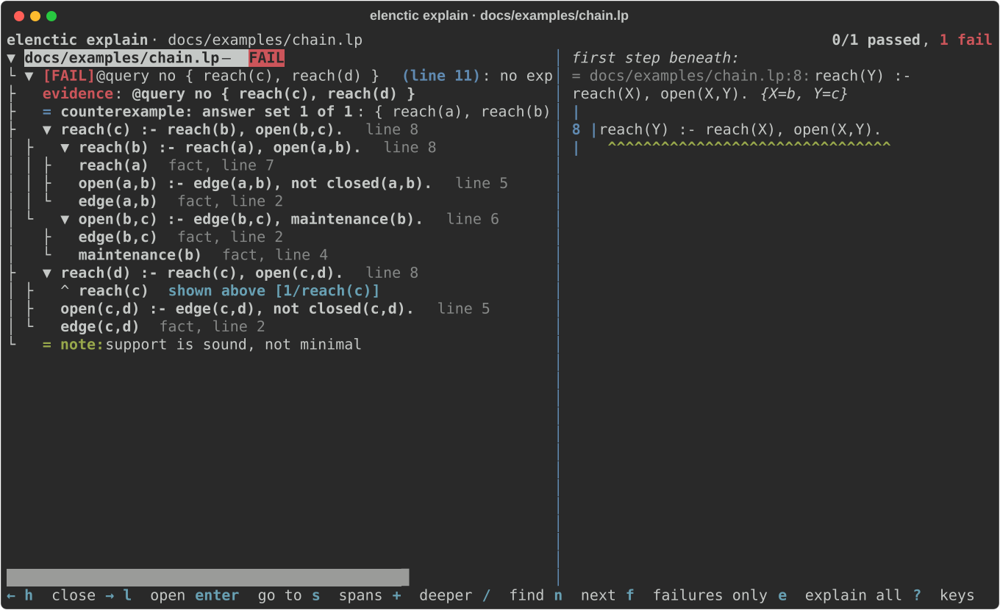

# elenctic

[](https://github.com/GregoryGelfond/elenctic/actions/workflows/ci.yml)
[](https://www.python.org/downloads/)
[](https://github.com/astral-sh/ruff)
[](https://mypy-lang.org/)
[](https://github.com/astral-sh/uv)
[](https://pixi.sh)
[](https://github.com/GregoryGelfond/elenctic/blob/main/LICENSE)
[](https://pypi.org/project/elenctic/)
[](https://anaconda.org/conda-forge/elenctic)

A testing and analysis library for answer set programs, with a thin CLI. Claims about a program
live in its own comments (`@expect`, `@count`, `@answer-set`, `@cautious`, `@brave`, `@query`,
`@cost`) and are checked under clingo or clingcon.

*Elenctic*, from Greek ἐλεγκτικός (ἔλεγχος, *elenchos*), "serving to refute by
cross-examination": the Socratic elenchus. A contract is a thesis about the program; `FAIL` is
its refutation, and `UNDECIDED` is aporia, an honest "cannot say" rather than a false "no".

## Install

Requires Python 3.14+ and clingo 5.8. The optional `theory` extra pulls in clingcon 5.2 for
contracts that declare `% @elenctic solver clingcon`; the optional `tui` extra pulls in Textual 8
for the interactive view.

```bash
# pip
pip install elenctic
pip install 'elenctic[theory]'
pip install 'elenctic[tui]'

# uv — as a project dependency, or as a tool on PATH
uv add elenctic
uv add 'elenctic[theory]'
uv tool install elenctic
uv tool install 'elenctic[theory]'

# pixi — from conda-forge
pixi add elenctic

# pixi — from PyPI
pixi add --pypi elenctic
pixi add --pypi 'elenctic[theory]'

# conda / mamba (conda-forge)
conda install -c conda-forge elenctic
mamba install -c conda-forge elenctic
```

From source, straight from Git or from a clone:

```bash
pip install 'elenctic[theory] @ git+https://github.com/GregoryGelfond/elenctic'

git clone https://github.com/GregoryGelfond/elenctic && cd elenctic
pip install '.[theory]'
uv tool install '.[theory]'
pixi install -e theory     # the locked environment
```

### Container

No prebuilt image is published. The `Containerfile` is a local recipe: build it yourself with
Docker or Podman, then mount a directory of `.lp` files and run a check.

```bash
docker build -f Containerfile -t elenctic .
podman build -f Containerfile -t elenctic .

docker run --rm -v "$PWD":/work:ro elenctic drinks.lp
podman run --rm -v "$PWD":/work:ro elenctic drinks.lp
```

The image includes the `theory` extra (clingo and clingcon). The entrypoint is `elenctic`; pass
the same arguments you would on the host.

## Quick start

Save this as `drinks.lp`:

```
% @expect sat
% @count 2
% @brave { tea, coffee }
% @cautious { biscuit }
% @query unknown { tea }
{ tea; coffee } = 1.
biscuit.
#show tea/0.
#show coffee/0.
#show biscuit/0.
```

```bash
$ elenctic drinks.lp
1/1 passed
```

Change `@count 2` to `@count 3` and run again:

```bash
$ elenctic drinks.lp
drinks.lp — FAIL
  [FAIL] @count 3 (line 2): 3 expected, 2 distinct shown answer sets

0/1 passed, 1 fail
```

`elenctic PATH…` is `elenctic test PATH…`. From Python the same check is silent and returns a
value:

```python
from elenctic import Limits, Program, check

report = check(Program.read("drinks.lp"), limits=Limits(max_seconds=10))
```

`ask` answers a query of a program, naming the answer sets that show its answer; `why` adds a
derivation in each:

```bash
$ elenctic ask drinks.lp tea --format text
ask: { tea }
 --> drinks.lp
  |
  = answer: unknown
  = true in answer set 1: { biscuit, tea }
  = neither tea nor -tea in answer set 2: { biscuit, coffee }
  |
  = help: `elenctic why drinks.lp tea --answer-set 1` shows why
```

## Usage

| | |
|---|---|
| `elenctic [test] PATH…` | check programs against their contracts ([reference](https://github.com/GregoryGelfond/elenctic/blob/main/docs/reference/reference.md#command-line)) |
| `elenctic explain PATH…` | `test`, and why each failed claim fails ([evidence](https://github.com/GregoryGelfond/elenctic/blob/main/docs/reference/reference.md#evidence)) |
| `elenctic ask PATH QUERY` | answer a query, `yes`, `no` or `unknown`, and name the answer sets that show it ([command line](https://github.com/GregoryGelfond/elenctic/blob/main/docs/reference/reference.md#command-line)) |
| `elenctic why PATH QUERY` | `ask`, with a derivation in each answer set it names; with `--answer-set K`, why a literal holds or fails in one ([evidence](https://github.com/GregoryGelfond/elenctic/blob/main/docs/reference/reference.md#evidence)) |
| `--mode default\|cautious\|brave` | how `ask` and `why` answer: three-valued, true in every answer set, or in some ([semantics](https://github.com/GregoryGelfond/elenctic/blob/main/docs/explanation/semantics.md)) |
| `--format text\|json\|tui` | text, JSON, or the interactive view, the default of `explain`, `why` and `ask` on a terminal with the `tui` extra ([output](https://github.com/GregoryGelfond/elenctic/blob/main/docs/reference/reference.md#output), [interactive view](https://github.com/GregoryGelfond/elenctic/blob/main/docs/reference/reference.md#the-interactive-view)) |
| `--with FILE` | load a library, such as a base encoding, with every case ([command line](https://github.com/GregoryGelfond/elenctic/blob/main/docs/reference/reference.md#command-line)) |
| `--short` | one line per diagnostic ([diagnostics](https://github.com/GregoryGelfond/elenctic/blob/main/docs/reference/reference.md#diagnostics)) |
| Exit `0` / `1` / `2` / `3` | claims hold, claim unmet, fault, internal error ([exit codes](https://github.com/GregoryGelfond/elenctic/blob/main/docs/reference/reference.md#exit-codes)) |



Claims, `ask` and `why` with real command output:
[docs/reference/examples.md](https://github.com/GregoryGelfond/elenctic/blob/main/docs/reference/examples.md).
Tutorial: [docs/tutorial/first-contract.md](https://github.com/GregoryGelfond/elenctic/blob/main/docs/tutorial/first-contract.md).
Full map: [docs/index.md](https://github.com/GregoryGelfond/elenctic/blob/main/docs/index.md).

## Develop

```bash
pixi install -e theory
pixi run -e theory check   # format, lint, strict types, import contracts, tests
pixi run -e py314 test     # or -e py315
```

`pixi run check` is the one gate; `./check.sh` runs it. `uv.lock` is tracked so
`uv sync --locked` reproduces the same dependencies.

## License

Licensed under the [MIT license](https://github.com/GregoryGelfond/elenctic/blob/main/LICENSE).
Changes are in the [changelog](https://github.com/GregoryGelfond/elenctic/blob/main/CHANGELOG.md).
